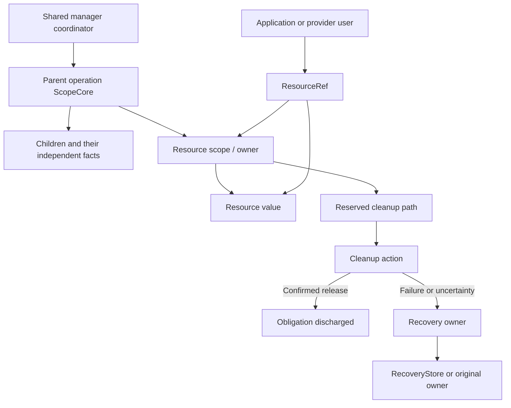
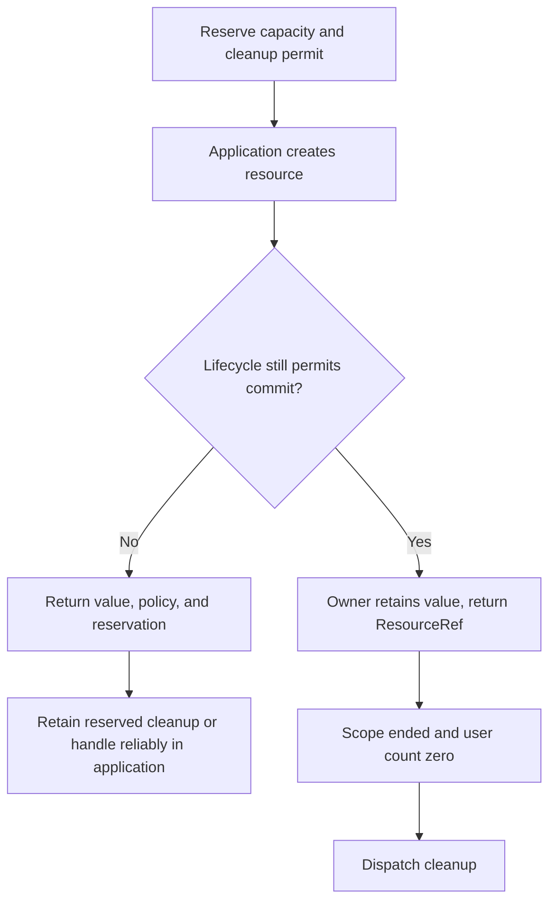
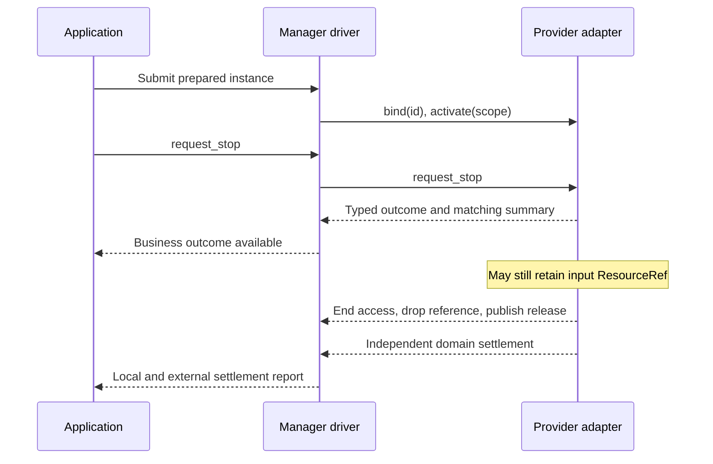
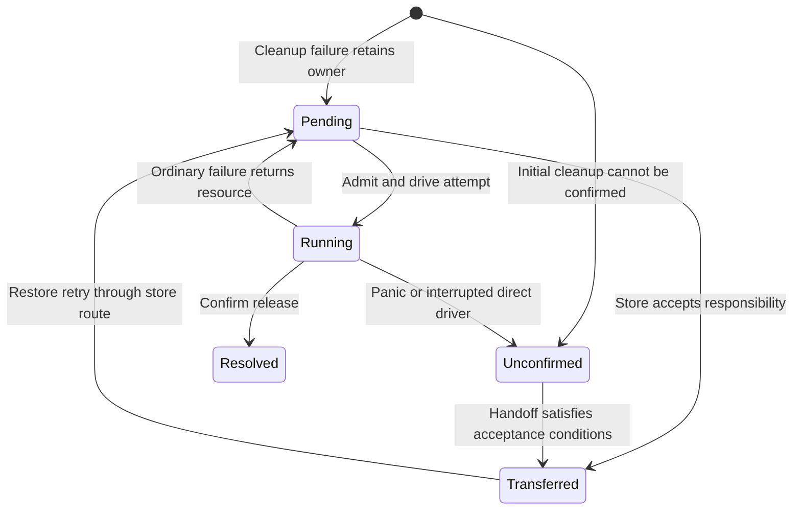
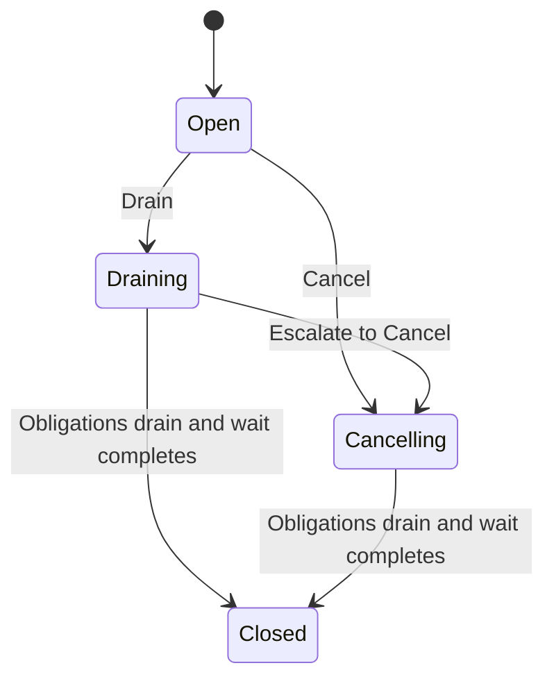

# rs-operation 0.3.0 Design

[中文](design-0.3.0.zh_CN.md) · [Developer guide](developer_guide-0.3.0.md) · [README](../README.md)

## Contents

- [1. Deriving the design from the problem](#1-deriving-the-design-from-the-problem)
- [2. Goals, non-goals, and scope](#2-goals-non-goals-and-scope)
- [3. Domain model: identity, authority, and ownership](#3-domain-model-identity-authority-and-ownership)
- [4. A multidimensional state model](#4-a-multidimensional-state-model)
- [5. Admission and capacity accounting](#5-admission-and-capacity-accounting)
- [6. Execution channels and concurrency boundaries](#6-execution-channels-and-concurrency-boundaries)
- [7. Resource protocol: reservation through cleanup](#7-resource-protocol-reservation-through-cleanup)
- [8. External-operation protocol and failure boundaries](#8-external-operation-protocol-and-failure-boundaries)
- [9. Composition, stop, and inherited policy](#9-composition-stop-and-inherited-policy)
- [10. Recovery and responsibility handoff](#10-recovery-and-responsibility-handoff)
- [11. Reports and observability](#11-reports-and-observability)
- [12. Shutdown protocol](#12-shutdown-protocol)
- [13. Invariants and failure policy](#13-invariants-and-failure-policy)
- [14. Tradeoffs, limits, and rules for future changes](#14-tradeoffs-limits-and-rules-for-future-changes)
- [15. Implementation and verification map](#15-implementation-and-verification-map)

## 1. Deriving the design from the problem

### 1.1 Completion is not one instant

Consider an upload service. Request bytes become an input resource, the application hands them to a background detector, and the detector may start child tasks. If the client disconnects, the business flow needs a stop outcome promptly even though the detector may still be reading. Resource release can subsequently fail and require another owner to continue cleanup.

At least five independent questions arise: was work admitted, what outcome did execution produce, who still accesses the resource, was cleanup confirmed, and who retains responsibility when confirmation is impossible? A single future's completion, cancellation flag, or destructor cannot answer all of them without losing information.

Rust ownership constrains memory access. It does not automatically organize an external SDK's stop semantics, remote-release confirmation, parent/child admission, and cleanup failures into an observable application protocol. This crate coordinates those relationships.

### 1.2 Consequences for the model

The problem leads to these requirements:

1. **Admission precedes an execution commitment.** Without task, result, resource, and cleanup capacity, reject while retaining the caller's inputs rather than start untracked work.
2. **Outcomes and resource obligations are separate.** A result may be ready while users still retain resources; failure does not establish absence of effects.
3. **Stop is a request.** The framework cannot infer that an arbitrary provider stopped reading simply because cancellation was requested.
4. **Cleanup requires closing new use and waiting for existing use to end.** Otherwise early business completion races with background access.
5. **Uncertainty needs an owner.** Unconfirmed release cannot become success or disappear when diagnostics are truncated.
6. **Composition propagates constraints.** Children cannot bypass ancestor quotas, cancellation, or service boundaries; optional work still owes settlement.
7. **Observation and control are distinct.** Reading lifecycle state must not take the typed result. Cancelling observation does not have identical execution effects in every driving mode.

These are design constraints, not guarantees of provider correctness, unlimited recoverability, or recovery after process failure.

## 2. Goals, non-goals, and scope

The crate provides sync/async managers, bounded admission, parent/child scopes, strong resource users, default and async cleanup, typed outcomes and settlement reports, an external-task protocol, explicit cleanup retries, and recovery-store handoff. It coordinates lifecycles rather than business algorithms.

Non-goals include ready-made file/MIME/command adapters, preemptive termination, business retry policies, rollback and compensation, durable event logs, distributed or crash recovery, and general deadlock detection. Applications supply truthful release evidence, synchronize mutable contents, investigate remote effects, and choose policies.

This document describes the current 0.3.0 model and implementation. The public boundary is the re-export set in `src/lib.rs`; private implementation remains under `src/v02/`. Internal dependency-graph and resource-group transfer facilities have no public configuration entry point. Module names and public report types do not imply downstream access. The actionable public responsibility handoff is `RecoveryHandle::transfer_to`.

## 3. Domain model: identity, authority, and ownership

### 3.1 Principal objects

| Object | Authority or responsibility | What it does not establish |
| --- | --- | --- |
| Manager view | Shared coordinator plus root/parent/group submission target | A separate executor or extended parent-scope lifetime. |
| OperationScope | Child submission, resource registration, and fact recording for one body | A cloneable, permanent submission entry point. |
| OperationHandle<T,E> | Unique typed receiver, control, and observation | Business or cleanup completion merely because a handle exists. |
| OperationObserver | Read-only lifecycle observation without typed consumption | Application-value handling. |
| ResourceScope | Heterogeneous owners and bounded cleanup obligations | Immediate invalidation of live references on closure. |
| ResourceRef<T> | One actual user's strong reference | Permission for new admission/lookup or synchronization of mutable T. |
| ResourceKey<T> | Lookup identity including manager/scope/slot/generation | Resource retention. |
| RecoveryHandle | Shared observation, retry, and transfer capability | An independent cleanup action for each clone. |
| RecoveryStore | Bounded recovery ownership and retry execution route | Persistence or automatic business compensation. |

Identities correlate outcome summaries, release evidence, and reports. Resource generations stop old keys from referring to a new resource after slot reuse; lookup also checks scope and type. An external adapter claims a manager-assigned identity and cannot reuse that instance under another identity.

### 3.2 Ownership graph

Owner lifetime and user references are deliberately separate. Scope end closes registration and lookup while existing references remain readable. Cleanup requires both scope end and a zero user count, even if business execution already stopped.

## 4. A multidimensional state model

### 4.1 Independent observations

| Dimension | Question | Representative states or values |
| --- | --- | --- |
| Admission | Did work enter the responsibility domain? | Rejection or a returned handle. |
| Execution | Is the body still progressing? | Queued, Running, Finished. |
| Stop | Has stop intent been recorded? | No request or the first accepted StopReason. |
| Outcome | Is the typed value available or consumed? | Outcome availability and receiver state. |
| Input release | Has an external user stopped accessing input? | Independent ChildRelease evidence. |
| Settlement | Can lifecycle obligations be given a reportable disposition? | Pending or a stable SettlementReport. |
| Recovery | Who advances unresolved cleanup? | Pending, Running, Resolved, Transferred, Unconfirmed. |

These dimensions coexist: a result can be consumed and execution finished while input release is unconfirmed; settlement can report RecoveryRequired even when business work succeeded. Execution == Finished is not release evidence.

### 4.2 Two gates: parent outcome and parent settlement

An ordinary parent's business outcome becomes ready after its body finishes and every Required child has an outcome. Optional children do not block this required-outcome gate. They still participate in settlement and are not detached.

Ordinary result resolution checks the first required-child failure, then context stop, then the body's Ok/Err. Any non-success required-child summary can produce ChildFailed, including stop, panic, and execution failure. Catching a child error in the parent body and returning Ok therefore does not erase a recorded required failure. External typed outcomes are likewise subject to required-child and context-stop resolution.

Parent settlement waits for more: body completion, the required child lifecycle facts of outcome/release/settlement, attached resource-scope completion, and applicable external domain evidence. Child input release cannot substitute for child settlement, and a child outcome cannot substitute for input release.

### 4.3 Consequences of result ownership

The typed result is delivered once; observers do not consume it. Taking or explicitly discarding it returns outcome capacity, but its contents may still own resource references. Keeping such a reference while waiting for settlement creates a self-wait. Thus `run_and_settle` is appropriate only when success and error values cannot retain references needed by that settlement.

Dropping an unfinished handle requests user cancellation and discards its result. Conversion to an observer only discards the result. Sync/async conversion moves the same receiving authority without starting another operation. Applications must distinguish these lifecycle actions.

## 5. Admission and capacity accounting

### 5.1 Complete reservation or rollback

Submission establishes lifecycle membership and execution capacity together. The production path broadly:

1. Validates manager phase, target, stop, time, and budget preconditions.
2. Resolves scope limits and acquires root-lifecycle or ancestor child-path permits plus outcome capacity.
3. Acquires queue and executor capacity and prepares a bounded cleanup dispatcher and resource scope.
4. Establishes parent/group lifecycle links; external submission performs one-shot bind and related pre-dispatch coordination.
5. Dispatches the complete reservation and returns a typed handle.

Intermediate failure rolls back acquired permits without calling the original body. `PermitBundle` atomically reserves the set of pools that must be acquired together; later executor and setup failures rely on RAII rollback. The entire submission is not one global atomic transaction over all state.

External AlreadyBound is a rejection, whereas Failed becomes an accepted setup failure. Framework RAII cannot undo arbitrary adapter callback effects; bind and abandon must follow their own contract.

### 5.2 Why Busy can follow a completed business result

| Permit | Held until |
| --- | --- |
| Root active-root | Operation settlement. |
| Unconsumed outcome | Outcome consumption or explicit discard. |
| Ancestor child-path | Both child settlement and outcome consumption/discard. |
| Service-group operation | Both settlement and outcome consumption/discard. |
| Queue | Job execution starts, or reservation rollback. |
| Resource/cleanup reservation | Responsibility moves with the committed resource, or the unused reservation is returned. |

In production, active_operations bounds unsettled root lifecycles rather than the number of running threads across a tree. Children do not consume another active-root slot, but still consume ancestor paths, global outcome/queue capacity, and executor capacity. This permits child progress while bounding admitted trees and retained results.

References kept after a business result delay root-capacity return. An unconsumed outcome after settlement still occupies outcome and potentially group/child-path permits. More workers cannot remove these obligations; diagnosis must begin with the release conditions.

### 5.3 Admission waiting is bounded too

`try_submit` attempts immediate admission. `submit` waits and retries only Busy; other failures return. Waiters have their own quota, eventual admission is not guaranteed, and there is no FIFO fairness promise.

A waiter does not retain partial business permits that block others. The coordinator uses a generation, waker registration, and rechecking to avoid missed notifications. Async waits require polling; sync waits must not occupy the worker needed by the awaited work.

### 5.4 Scope inheritance and shared ancestor budgets

A complete `ScopeLimits::default()` is the inheritance sentinel and selects the manager configuration. Any other structure supplies the whole request, without field-by-field merging. Child effective capacities are then narrowed by ancestors, and actual reservations charge ancestor pools.

For example, if manager resources=20 and a root operation changes only effect_records to 8 in an otherwise default structure, it requests resources=128 and effects=8, not inherited resources=20. Roots can override manager scope defaults; descendants remain bounded by every ancestor. Siblings share ancestor budgets rather than each receiving another copy.

Creating a child scope does not pre-reserve all configured capacity. Actual descendants and resources acquire permits when admitted. Limits bound simultaneously retained responsibility, not historical lifetime operation counts; released capacity can be reused.

## 6. Execution channels and concurrency boundaries

### 6.1 Shared coordination, separate execution

| Work | Execution path |
| --- | --- |
| Ordinary synchronous body | Synchronous thread pool. |
| Async operation future | Portable async executor workers. |
| External driver from either manager view | Async executor capacity and workers. |
| Actual provider work | Provider- or application-owned execution. |
| Resource cleanup | Separate cleanup execution and wakeable pump. |
| Store recovery attempt | Store-owned bounded execution. |

External drivers from sync managers use the async channel so provider polling does not occupy a synchronous worker needed by child work. Isolation addresses that contention, not every application wait cycle. Adapter poll, activate, and stop callbacks must remain short and non-blocking.

Cleanup reserves its path before dispatch. When execution cannot accept a job immediately, retained queues still own the job, value, and policy rather than casually dropping cleanup responsibility. Size cleanup concurrency separately from business concurrency.

### 6.2 Locks, wakeups, and user code

Scopes, owners, admission coordination, outcome slots, and recovery records protect their respective shared state. The implementation records one-shot transitions under synchronization and moves callbacks or wakeups to the appropriate execution boundary. Downstream adapters must likewise coordinate checking a fact with registering its waker or risk an event arriving between them and leaving a permanent wait.

Capacity notifications capture the currently registered waiter slots as one fixed batch while advancing the generation under the state lock. Wake callbacks and waiter destruction happen after unlocking; registrations created by a callback belong to a later notification.

The external driver catches unwind panics around several callbacks and validates identity/result consistency. This does not reconstruct arbitrary corrupted provider state or cover abort. Cleanup uncertainty must remain explicit; catching a panic does not justify Released.

Synchronous worker settlement waits have WouldDeadlock protection. Manager/group shutdown waits also recognize operations inside their target, with zero-duration observation available as a special case. There is no general lock-graph detector; other cycles, including blocking child waits, remain application concerns.

## 7. Resource protocol: reservation through cleanup

### 7.1 Three steps with explicit ownership on failure

`manage` reserves and commits an already-created resource, returning it on failure. Explicit reserve is needed when creation itself requires an established cleanup path. Reservation cannot prevent a later stop or scope end. Commit errors retain the resource and reservation for `retain_for_cleanup` or its custom-policy counterpart.

Unused reservations also contribute to pending completion. Applications must commit or release them promptly; retaining a reservation forever can block settlement just as a retained resource user can.

### 7.2 User gates and lookup

Every ResourceRef clone increments an independent user count. Scope end closes registration and lookup while live references remain readable. Cleanup waits for their final return. Typed keys do not count as users; wrong-scope or old-generation lookup is rejected.

T must be Send + Sync + 'static. The framework provides shared borrowing, not arbitrary mutable access. Applications synchronize interior mutability. Entry-count limits do not bound resource payloads or error-source size.

### 7.3 Cleanup outcomes and uncertainty

Default cleanup drops the value. Custom AsyncCleanup receives ownership and an independent CleanupContext, returning a sendable future. Released requires confirmation, Failed must return the resource, and Transferred requires receiver-issued evidence.

A cleanup panic or unconfirmed interrupted driving future can leave partial effects. The framework retains the unconfirmed capsule, action, and capacity obligation instead of claiming release. This may retain responsibility indefinitely; it is not a promise of eventual automatic release or retry. Reliable application policies should return diagnosable failures with the resource whenever possible.

### 7.4 Service resources and operation resources

Operation resources settle with the request tree. A group's ServiceResourceScope owns cross-request values under separate entry limits, such as a shared model or configuration. Closing it stops new admission while existing users retain their resources.

Service resource scopes participate in manager shutdown. Both Drain and Cancel end manager-owned service scopes. Applications should stop new use and return references before expecting shutdown completion, rather than wait for shutdown before releasing those references.

## 8. External-operation protocol and failure boundaries

### 8.1 Prepare, claim, activate

PreparedExternalOperation binds externally owned work into manager responsibility. Bind claims identity once, activate receives the OperationScope and starts or hands off work, and abandon releases a claimed preparation that was not activated. AlreadyBound rejects and returns the instance; Failed becomes an accepted ExecutionFailed.

Binding is one-shot across managers too. Preparation should remain suitable for admission rather than create irreversible work beforehand. A manager can return the prepared instance, not undo work the application launched outside its boundaries.

### 8.2 Three facts and two outcome ports

poll_take_outcome transfers the unique typed result. OperationControl::poll_outcome supplies a non-consuming summary whose identity and outcome kind must match. Its diagnostic text can differ and is not the equality criterion.

poll_release and poll_settlement independently report the end of input use and domain settlement. The driver needs outcome publication, actual input release, and a domain report before finishing external settlement. Outcome does not imply release, and release does not imply settlement.

This is one legal timeline, not a mandated order for every provider. The manager can retain independently arriving facts. The invariant is that one fact cannot manufacture another.

### 8.3 Protocol faults

The driver validates pre-activation snapshot identity, typed-result/summary kind, and release/domain-report identities. Mismatches and some callback panics become ExecutionFailed. Broken release or settlement ports may prevent settlement from completing. Failure to report is not proof of release. Handles and observers expose a bounded `external_protocol_faults()` snapshot with at most the first fault for each port, in Release then Settlement order. A fault records the category and, for identity mismatch, the observed identity; it does not replace release evidence or publish a domain settlement report.

Domain reports must be independent of the manager's final report, which is waiting for them. Waiting in the opposite direction creates a cycle. Adapters retain the ResourceRef needed by each actual worker until access ends, not merely until the provider returns Cancelled.

## 9. Composition, stop, and inherited policy

A manager view from scope.manager() carries a weak parent target and shares the coordinator. Submissions fail after parent scope end. with_group preserves that target while adding deduplicated service-group constraints. A configured maximum distinct group count bounds target metadata.

Required/Optional determines whether child failure affects the parent. The parent's child_failure_policy controls its response to required failure: StopSiblings sends cooperative RequiredChildFailed; ContinueSiblings retains failure while allowing other work. Choose the policy before submission; a parent Ok cannot rewrite it afterward.

OperationContext clones share their stop node; child contexts get descendant nodes. The first stop reason persists and propagates downward. A child deadline cannot extend the effective ancestor deadline; incompatible clock domains are rejected. Budget policies accumulate instead of overriding ancestors.

CleanupContext neither inherits the business stop tree nor contains a stop node. It checks only its independently configured deadline and budget policies so business stop does not directly prevent required cleanup. context.check inspects policy; it neither reserves capacity nor preempts arbitrary code.

## 10. Recovery and responsibility handoff

### 10.1 State machine

Recovery phase and store membership are different: a return from Transferred to Pending/Running does not remove store ownership. The store retains the group until it is Resolved and pruned.

This describes recovery responsibility, not the original business outcome. After transfer, the store route continues managing attempts. Interpret original-handle observation together with store snapshots; transferred does not mean released.

Only one attempt per group can run. try_retry admits an attempt rather than guaranteeing completion; a waiter must drive it. Direct mode is driven by the first observer. Dropping that pending driving wait retains the unfinished action and records Unconfirmed. In store-executor mode, cancelling observation does not stop an already dispatched worker.

Unconfirmed may disable automatic retry and cause later ExecutorUnavailable. Repeating partially completed cleanup blindly may be unsafe. RecoveryAttempt::finish can apply external evidence only while the shared run has not been taken by a waiter; it is not a general force-success switch.

### 10.2 Acceptance receipts and the previous owner

RecoveryStore validates state, identity, group contents, and capacity before issuing a receipt and taking over the retry route. A successful first acceptance permanently assigns the group to that store independently of phase; retries returning to Pending or Unconfirmed do not make it transferable again. A second store receives AlreadyTransferred without changing the original membership or route. Choose a long-lived store before the first transfer and perform subsequent retries there. A pre-acceptance failure produces no receipt and leaves the handle available. Retry through an old handle routes to the accepted store; store.try_retry(id) is the explicit store entry point. Dropping the store does not return responsibility to the handle.

Transfer means accepted responsibility, not resource release. The store independently limits groups, resources, and cleanup concurrency. Closing admission does not automatically retry every unresolved group. There is no persistence guarantee; crash recovery requires an application protocol.

A completed recovery future is explicitly dropped inside a panic boundary after it returns Ready. If that final destructor panics, its result is not trusted: the group becomes Unconfirmed, retains its owner and action, and publishes the attempt report. The returned value is also disposed behind an unwind boundary. This conservative result applies even when poll returned success because the destructor may still perform required cleanup.

Once finalization has reliable evidence that cleanup succeeded, later panics while dropping old failure sources or completed run, action, payload, and wrapper references do not revoke Resolved or the cleared history. Each such value is dropped behind its own unwind boundary, after which terminal notification and attempt-report publication continue. If a retry failed, a panic while dropping an evicted diagnostic source leaves the group Pending with the existing bounded history, total, and truncation semantics; its attempt report can still be published. A panic during cleanup construction or polling, or during destruction of the Ready future, remains Unconfirmed and retains the owner, action, or future under the existing rules. These guarantees cover the described finalization drops; they do not imply that every callback or waker panic is caught, that panic=abort is recoverable, or that the system provides a complete panic audit.

### 10.3 Bounded history independent of ownership

Recovery snapshots retain the latest 64 failures, oldest to newest. Totals saturate, truncation marks eviction, and confirmed success resets history. Attempt failures represent retained history at completion, not only that attempt's events.

Diagnostic arrays are separate from recovery ownership, so eviction cannot discharge responsibility. Entry-count bounds still do not bound total bytes: error sources and resource payloads remain application-controlled.

## 11. Reports and observability

### 11.1 Local, child, and external evidence

A SettlementReport's counts and details describe its local scope. Child operations are nested as ChildSettlement in children; domain evidence is retained as external_settlement. This is not a flattened total across all layers.

Local status derives from local cleanup/recovery/transfer facts and combines with external status in order RecoveryRequired > Transferred > Released. It does not combine every child's status. all_released checks the local layer and external report, not children.

Therefore parent all_released == true does not establish release throughout the tree. Recurse into children and account for truncated details for tree-wide decisions. Maintain observations and application records continuously when a complete recovery index is necessary. Deduplicate by resource identity where local and domain reports overlap before taking action.

### 11.2 Stable reports are not live recovery state

Bounded detail arrays with total/truncated fields and effect overflow distinguish no events from incomplete retention. Missing details cannot prove release. Published settlement is immutable; later recovery progress belongs to RecoveryHandle/store snapshots.

EffectRecord stores application claims, with Known/Unknown certainty. It does not trigger compensation or provide durable transactions. Stop or scope end prevents new records; exhaustion preserves existing facts, returns an error, and increments overflow.

### 11.3 Shutdown snapshot accounting

ShutdownSnapshot helps locate outstanding responsibility; field names are not exact counts of every underlying object. Current production service_resources counts service resource scopes, while unconfirmed_users comes from Unconfirmed recovery records rather than all ResourceRef instances. Combine these diagnostics with operation, resource, and recovery snapshots.

## 12. Shutdown protocol

Drain rejects new root submissions while allowing accepted open parents to submit descendants, so an admitted tree can finish. Cancel additionally rejects new ordinary child submissions and requests ManagerShutdown on active scopes. Drain cannot downgrade Cancel.

Both modes end manager-owned service resource scopes. Waiting tracks active scopes, service scopes, and recoveries, then shuts down and joins executors. Initiating shutdown or dropping a handle is not completed join; retain and explicitly wait on the shutdown handle.

Shutdown may remain pending while workers use input, cleanup is unconfirmed, or recovery ownership is unresolved. A timeout ends observation, not responsibility. Blocking shutdown waits from operations inside the target manager/group are rejected to prevent self-wait; zero-duration snapshot observation is a special case.

Recovery-store shutdown also separates closing admission from waiting for completion and does not automatically schedule recovery. Application shutdown order must follow dependencies among services, shared resources, providers, and recovery services.

## 13. Invariants and failure policy

| Invariant | Risk if broken | Mechanism or application obligation |
| --- | --- | --- |
| Reserve completely before admission or roll back | Untracked work and cleanup debt | Reservation/permit RAII and original-input return. |
| Unique typed receiving authority | Duplicate delivery or competing consumption | Outcome slot and handle transfer. |
| Parent constraints follow actual scopes | Children bypass capacity or cancellation | Bound manager views and ancestor permits. |
| Cleanup waits for scope end and zero users | Premature release of in-use input | Owner user gate and truthful provider references. |
| Unconfirmed release never becomes Released | Hidden cleanup leaks | Failed returns resources; Unconfirmed retains action responsibility. |
| Transfer requires receiver acceptance first | Sender forgets ownership before handoff | Receipts and store validation. |
| Truncating diagnostics cannot discard recovery ownership | Diagnostic quota changes resource safety | Separate owner tracking. |
| Domain settlement cannot depend on final manager settlement | Cyclic wait | Independently generated adapter evidence. |

## 14. Tradeoffs, limits, and rules for future changes

Independent facts require more caller checks but let business responses precede cleanup. Strong users make ownership explicit while allowing leaked references to block shutdown visibly. Reserving cleanup space improves traceability without making remote cleanup infallible.

Separate execution channels reduce certain contention but add capacity dimensions; general deadlocks and unbounded blocking remain outside the model. Bounded reports control retained entries, while complete audits and recovery indexes require continuous application records. Recovery handoff helps service shutdown but adds neither persistence, idempotency, nor distributed consistency.

Future public dependency/transfer APIs, permit-release changes, or flattened reports must re-examine whether owners stay reachable, old results retain quotas, stop can race safely with submission, truncation affects responsibility, and adapters can create cycles. A convenience method must not bypass these invariants.

## 15. Implementation and verification map

| Topic | Main implementation | Verification entry points |
| --- | --- | --- |
| Admission and permit return | manager/production, manager/capacity, production_lease | v02_capacity, v02_production tests. |
| Parent outcome/settlement gates | scope/internal/scope_core, scope_state | v02_tree, v02_group, v03_lifecycle. |
| Scope inheritance and groups | report/options, manager/group | v03_contract, v03_scope. |
| User references and reservation | resource/core, resource_ref, resource_reservation | v02_resources, v03_lifecycle. |
| Cleanup and recovery | resource/cleanup, resource/recovery | v02_cleanup, v02_shutdown, internal recovery tests. |
| External protocol | manager/core/external_operation_driver, adapter | v03_external. |
| Report layers and truncation | manager/core/internal/manager_core, report/settlement | v02_report, v03_external. |
| Shutdown and service resources | manager/shutdown, resource/service | v02_shutdown, v02_service_resource. |

Implementation paths in this table are under `src/v02/`; test names refer to Cargo test targets. Run `cargo test --locked` from the crate root for behavior and `cargo check --examples --locked` for integration examples. The developer guide contains application steps, configuration values, and compilable code.
