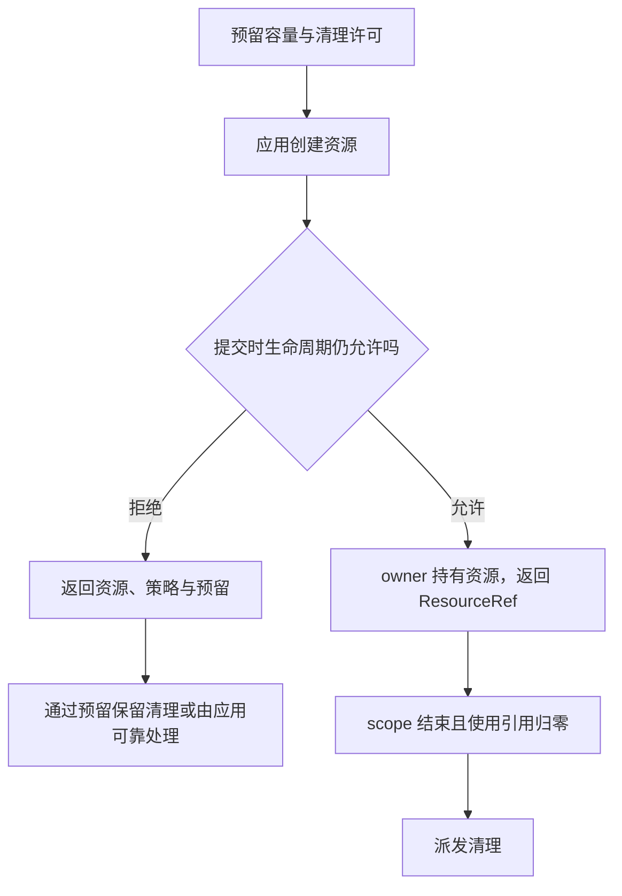
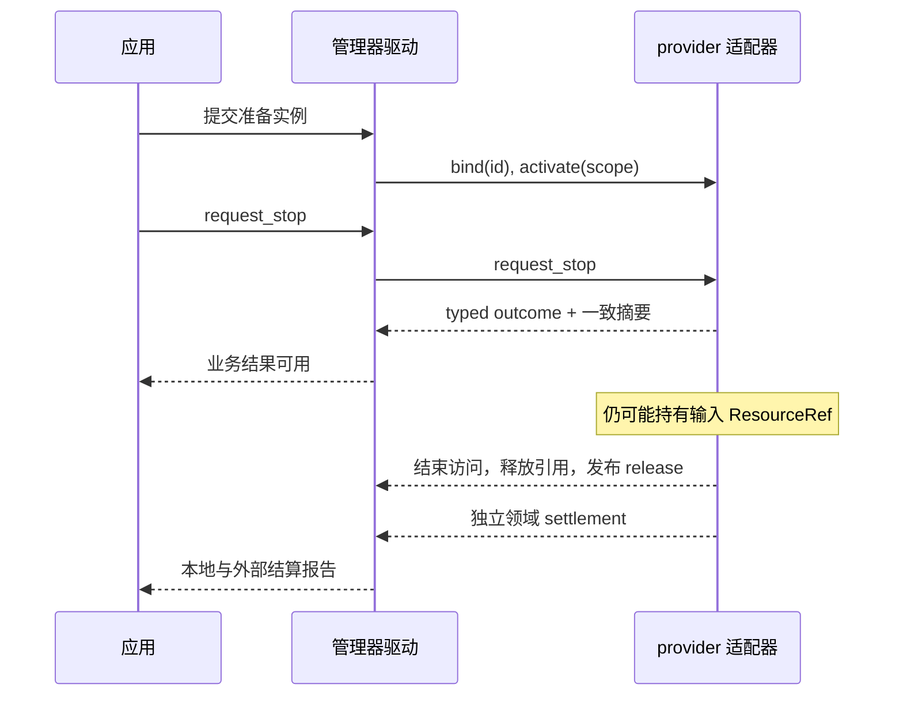
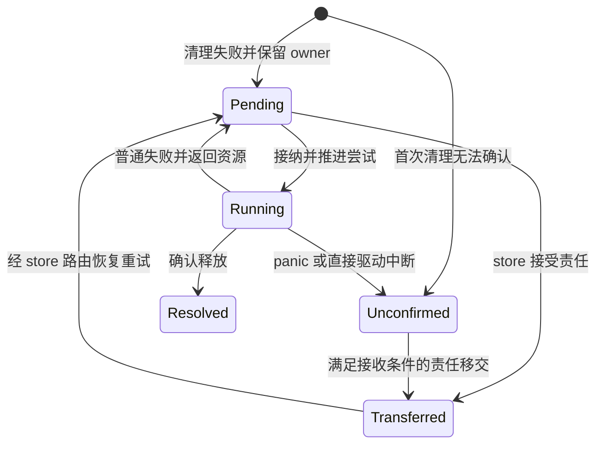
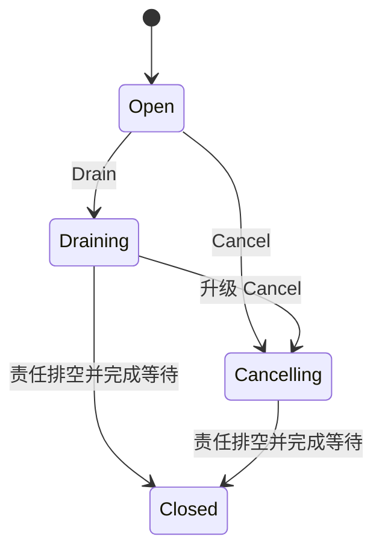

# rs-operation 0.3.0 设计文档

[English](design-0.3.0.md) · [开发者手册](developer_guide-0.3.0.zh_CN.md) · [README](../README.zh_CN.md)

## 目录

- [1. 从什么问题推导设计](#1-从什么问题推导设计)
- [2. 目标、非目标和文档边界](#2-目标非目标和文档边界)
- [3. 领域模型：身份、权限和所有权](#3-领域模型身份权限和所有权)
- [4. 状态模型不是单一状态枚举](#4-状态模型不是单一状态枚举)
- [5. 准入协议与容量记账](#5-准入协议与容量记账)
- [6. 执行通道与并发边界](#6-执行通道与并发边界)
- [7. 资源协议：从预留到清理](#7-资源协议从预留到清理)
- [8. 外部操作协议与故障边界](#8-外部操作协议与故障边界)
- [9. 组合、停止和策略继承](#9-组合停止和策略继承)
- [10. 恢复模型与责任移交](#10-恢复模型与责任移交)
- [11. 报告模型与可观察性](#11-报告模型与可观察性)
- [12. 关闭协议](#12-关闭协议)
- [13. 关键不变量与失败策略](#13-关键不变量与失败策略)
- [14. 取舍、限制与未来修改准则](#14-取舍限制与未来修改准则)
- [15. 实现与验证映射](#15-实现与验证映射)

## 1. 从什么问题推导设计

### 1.1 操作结束不是一个瞬间

考虑上传服务：请求体成为输入资源；应用把它交给后台检测器；检测器可能再提交子任务。客户端断开后，业务需要尽早得到停止结果，但检测器可能仍读取输入。随后资源释放也可能失败，需要其他责任方继续清理。

这里至少有五个独立问题：工作是否被接纳、执行产生什么结果、谁仍在访问资源、清理是否得到确认、无法确认时由谁持有责任。用一个 future 的完成状态、一个 cancellation flag 或一个析构函数回答所有问题，都会丢失其中一部分事实。

Rust 所有权能约束内存访问，却不会自动把外部 SDK 的停止语义、远端释放确认、父子任务准入和清理失败组织成应用可观察的协议。本库要填补的是这些事实之间的协调关系。

### 1.2 核心推论

由上述问题得到以下设计要求：

1. **接纳必须先于执行承诺。** 没有足够任务、结果、资源与收尾容量时，应保留调用方原输入并拒绝，而不是先启动不可追踪的工作。
2. **业务结果与资源责任分开。** 结果可以就绪，资源仍由使用者持有；失败也不等于没有副作用。
3. **停止只能是请求。** 框架无法凭取消请求证明任意 provider 已停止读取输入。
4. **清理之前必须关闭新增使用并等待已有使用退出。** 否则业务提前结束会与后台访问竞争。
5. **清理不确定性必须有所有者。** 未确认释放不能改写为成功，也不能因诊断截断而遗失责任。
6. **组合必须传递约束。** 子任务不能绕过父级额度、停止树或服务边界；可选任务也不能自动脱离收尾。
7. **观察和控制不能混淆。** 读取状态不应抢走 typed 结果；取消观察不应在所有执行模式下都被解释成取消工作。

这些是设计约束，不是对 provider 正确性、无限可恢复性或进程崩溃后恢复的承诺。

## 2. 目标、非目标和文档边界

本库提供同步/异步管理器、有限准入、父子 scope、资源强引用、默认及异步清理、typed 结果与结算报告、外部任务协议、显式恢复重试和恢复 store 移交。它协调生命周期，不决定业务算法。

不在范围内的能力包括：文件/MIME/命令成品适配器、任意代码抢占终止、业务重试策略、事务回滚与补偿、持久化事件日志、分布式或崩溃恢复、通用死锁检测。应用负责真实资源释放证据、共享可变内容同步、远端效果核实及策略选择。

本文解释当前 0.3.0 的模型和实现。公开边界以 `src/lib.rs` 的 re-export 为准，私有实现仍位于 `src/v02/`。内部依赖图与整组资源转移设施没有公开配置入口；不能根据模块名或公开报告类型推断下游可以调用它们。可操作的公开责任移交是 `RecoveryHandle::transfer_to`。

## 3. 领域模型：身份、权限和所有权

### 3.1 核心对象

| 对象 | 持有的权限或责任 | 不代表什么 |
| --- | --- | --- |
| Manager view | 共享协调器，加 root/parent/group 提交目标 | 不一定拥有独立执行器，也不延长父 scope 的开放时间。 |
| OperationScope | 一次操作体的子提交、资源登记和事实记录权限 | 不是可 clone 的永久任务入口。 |
| OperationHandle<T,E> | 唯一 typed 结果接收权及控制/观察入口 | handle 存在不意味着业务或清理已完成。 |
| OperationObserver | 无 typed 消费权的只读生命周期观察 | 不替代业务值处理。 |
| ResourceScope | 异构资源 owner 集合与有界清理责任 | scope 关闭不意味着现存引用立即失效。 |
| ResourceRef<T> | 一个实际使用者的强引用 | 不开放新的登记或查找，也不同步 T 的可变内容。 |
| ResourceKey<T> | 带 manager/scope/slot/generation 的查找标识 | 不保活资源。 |
| RecoveryHandle | 同一恢复组的观察、尝试和移交能力 | clone 不产生独立清理动作。 |
| RecoveryStore | 有界恢复 owner 持有与重试执行路径 | 不提供持久化或自动业务补偿。 |

身份用于关联 typed 结果摘要、释放证据和报告。资源代次避免旧键误指槽位复用后的新资源；查找还校验 scope 与类型。外部适配器认领管理器分配的身份，不能给一个已认领实例重新分配另一个身份。

### 3.2 所有权图

```mermaid
flowchart TD
    M[共享管理器协调器] --> P[父操作 ScopeCore]
    P --> C[子操作与其独立事实]
    P --> R[资源 scope / owner]
    R --> V[资源值]
    U[应用或 provider 使用者] --> H[ResourceRef]
    H --> V
    H --> R
    R --> Q[预留清理路径]
    Q --> X[清理动作]
    X -->|确认释放| D[责任解除]
    X -->|失败或不确定| F[恢复 owner]
    F --> S[RecoveryStore 或原责任方]
```

owner 和使用引用被有意分开：scope 结束关闭新登记与查找；现存引用保持值可读。只有 scope 已结束且使用者计数为零，资源才能进入清理。即使业务已停止，这个条件也不能被省略。

## 4. 状态模型不是单一状态枚举

### 4.1 分离观察维度

| 维度 | 问题 | 典型状态或值 |
| --- | --- | --- |
| 准入 | 工作是否进入责任域 | 拒绝或返回 handle。 |
| 执行 | 操作体是否仍在推进 | Queued、Running、Finished。 |
| 停止 | 是否已记录停止意图 | 未请求或首个接受的 StopReason。 |
| 结果 | typed 值是否可用/已消费 | outcome availability 与唯一接收端状态。 |
| 输入释放 | 外部使用者是否停止访问 | 独立 ChildRelease 事实。 |
| 结算 | 生命周期是否已有可报告归结 | Pending 或稳定 SettlementReport。 |
| 恢复 | 未解决清理由谁推进 | Pending、Running、Resolved、Transferred、Unconfirmed。 |

这些维度可以组合：结果已消费、执行结束，但输入释放仍未确认；或者结算已发布为 RecoveryRequired，业务却成功。不能用 execution == Finished 作为资源释放证明。

### 4.2 双门控：父结果与父结算

普通父操作的业务结果就绪要求父操作体已结束，且所有 Required 子操作都有 outcome。Optional 子操作不阻塞这一组必需结果门控；它们仍参与结算，不能视为 detached。

普通结果解析先检查第一个必需子失败，其次检查上下文停止，再使用操作体的 Ok/Err。必需子任何非成功摘要均可形成 ChildFailed，包括停止、panic 和执行失败。因此父闭包捕获子错误并返回 Ok，也不能抹去已登记的必需失败。外部 typed outcome 同样受必需子失败和上下文停止约束。

父结算等待更多事实：操作体结束、子生命周期所需的 outcome/release/settlement 到齐、附属资源 scope 收尾，以及适用的外部领域报告。子输入已释放不能代替子结算；拿到子结果也不能代替输入释放。

### 4.3 结果所有权的后果

结果只交付一次，观察者不会消费它。取走或明确丢弃结果会归还结果容量，但结果内容仍可能持有资源引用。若调用方握住该引用等待结算，就制造了自身等待。因此 `run_and_settle` 只适用于返回值和错误不保留待结算使用引用的场景。

直接 drop 未结束 handle 请求用户取消并丢弃结果。转换为 observer 仅丢弃结果；同步/异步 handle 转换移交同一接收权，不启动第二个操作。这些动作的区别必须在应用生命周期设计中明确。

## 5. 准入协议与容量记账

### 5.1 完整预留或回滚

一次提交需要同时建立生命周期关联和执行能力。生产提交路径大致如下：

1. 校验 manager phase、提交目标、停止、时间与预算前置条件。
2. 解析 scope limits，取得根生命周期或祖先 child-path 许可，以及结果许可。
3. 取得队列与对应执行器容量，准备有界 cleanup dispatcher 和资源 scope。
4. 建立父/组生命周期登记；外部提交执行一次性 bind 等预提交协调。
5. 移交完整预留给执行器；返回 typed handle。

任何中途失败都回滚已持许可，原闭包尚未调用。`PermitBundle` 对需要共同取得的一组池做原子预留；后续执行器等步骤通过 RAII 回滚。整个提交不是一个包办所有状态的全局原子事务。

外部 bind 的 AlreadyBound 是拒绝；Failed 则作为已接纳设置失败交给 handle。适配器回调自身的副作用不可能仅凭框架 RAII 自动撤销，所以 bind 和 abandon 必须按协议设计。

### 5.2 为什么结果已返回仍可能 Busy

| 许可 | 持有到什么时候 |
| --- | --- |
| 根操作 active-root | 操作结算完成。 |
| 未消费结果 | 结果取走或明确丢弃。 |
| 祖先 child-path | 子结算完成且结果已取走/丢弃。 |
| 服务组操作许可 | 结算完成且结果已取走/丢弃。 |
| 队列许可 | 作业开始执行，或预留回滚。 |
| 资源/清理预留 | 提交后随资源责任转移，或未消费预留被归还。 |

生产实现中的 active_operations 控制未结算根生命周期，不是整棵树最多运行多少线程。子操作不重复消耗根 active 额度，但仍消耗祖先路径、全局结果/队列和执行器容量。这个选择让子任务可以推进，同时限制已接纳树与尚未释放结果。

业务返回后保留资源引用会延迟根额度归还；结算完成却不取结果会继续占用 outcome 和可能的组/child-path 额度。单纯增加 worker 不能消除这些占用。诊断必须从许可归还条件入手。

### 5.3 等待准入也有界

`try_submit` 即时尝试；`submit` 只针对 Busy 等待并重试，其他错误返回。等待者本身有容量上限，不保证最终接纳，也没有 FIFO 公平性承诺。

等待期间不持有一部分业务许可阻塞其他提交。协调器用 generation、waker 登记与再次检查避免丢失通知。异步等待需要 caller poll；同步等待必须避免占住推进被等待任务的 worker。

### 5.4 Scope 的配置继承和共享预算

完整 `ScopeLimits::default()` 用作继承哨兵，替换成管理器配置；其他结构值整体作为请求，不逐字段合并。随后子 scope 的有效额度按祖先约束收窄，实际预留沿祖先池记账。

例如管理器 resources=20，根 operation 只把默认结构的 effect_records 改成 8，则它请求的是 resources=128、effects=8，不会自动继承 20。根可以覆盖 manager 的 scope 默认；子请求仍受每个祖先有效容量限制。兄弟共享祖先预算，不是每人额外得到一份。

建立子 scope 不预占其配置中的全部额度，实际提交后代或登记资源时才取得许可。容量限制针对同时保留的责任，释放后可复用；并非整个进程历史累计任务数。

## 6. 执行通道与并发边界

### 6.1 共享协调，不同执行通道

| 工作 | 执行位置 |
| --- | --- |
| 普通同步闭包 | 同步线程池。 |
| 异步闭包 future | portable async executor 的 worker 轮询。 |
| 同步/异步管理器的外部 driver | 异步执行器容量与 worker。 |
| provider 真正工作 | provider 或应用自己的执行路径。 |
| 资源清理 | 独立清理执行路径及可唤醒 pump。 |
| store 恢复尝试 | store 自己的有界执行路径。 |

同步管理器驱动外部任务仍使用异步通道，避免 provider 轮询占据它依赖的同步子任务 worker。隔离只消除这一类争用，不保证不存在应用层循环等待。适配器 poll、activate、stop 等回调必须短且非阻塞。

清理先有预留，再派发。当执行器暂时不能接纳，队列仍持有任务、资源和策略，不把清理责任退化成随意 drop。清理并发配置与业务并发应分别考虑。

### 6.2 锁、唤醒和用户代码

scope、资源 owner、准入协调器、结果槽和恢复状态各自保护共享状态。实现通过受保护状态记录一次性事件，再移出回调或唤醒参与者。下游适配器也必须把“检查事实”和“登记 waker”同步协调，否则事件可能落在二者之间导致永久等待。

外部驱动对多个回调捕获 unwind panic，并检查身份/结果一致性；这种防御不等于能重建任意受损 provider 状态，也不覆盖 abort。清理不确定性必须保留，不得因捕获 panic 就发布 Released。

同步 worker 上的结算等待有 WouldDeadlock 防护。manager/group shutdown 等待也识别当前目标内的操作；零时长观察可用于获取状态。没有通用锁图检测，阻塞等待子任务等其他应用环仍需调用方避免。

## 7. 资源协议：从预留到清理

### 7.1 三步协议

`manage` 对已有资源内部完成预留与提交，失败退回原值。需要保证创建前有收尾空间时使用显式 reserve。预留成功不能阻止随后发生的停止或 scope end；错误必须保留资源与预留，允许 `retain_for_cleanup` 或带策略版本继续承担责任。

没有消费的预留也参与 completion 等待，因此应用应及时提交或释放。只创建预留并永久持有同样可能阻碍结算。

### 7.2 引用门控与查找

每个 ResourceRef clone 都增加独立用户计数。scope end 后关闭登记和查找，现存引用继续可读，最后一个引用归还后才能清理。typed key 不增加用户计数；旧代次或错误 scope 的 lookup 被拒绝。

T 要求 Send + Sync + 'static，框架提供共享借用，不提供任意可变访问。应用必须使用同步类型保护内部可变数据。资源值本身或错误来源的大小不受条目上限限制。

### 7.3 清理结果和不确定性

默认清理执行 drop；自定义 AsyncCleanup 接收资源所有权和独立 CleanupContext，返回 sendable future。Released 必须来自真实释放确认，Failed 必须带回资源，Transferred 必须有接收方凭据。

当清理 panic 或正在驱动的 future 无法确认完成时，资源可能已被部分处理。框架保留未确认 capsule、动作和容量责任，优先防止虚假释放；这可能导致长期持有，不能承诺总能自动释放或重试。应用的可靠清理策略应尽可能返回带资源的可诊断失败。

### 7.4 服务资源与操作资源

操作资源随请求树收尾。服务资源由 group 的 ServiceResourceScope 拥有，独立限制共享条目，适合跨请求模型或配置。关闭服务 scope 只结束新接纳，现存用户继续持有资源。

服务资源 scope 参与管理器关闭。manager 发起 Drain 或 Cancel 都会结束其拥有的服务资源 scope。应用应先停止新使用，再归还引用；不能等待 manager shutdown 后才释放服务资源引用，否则依赖顺序相反。

## 8. 外部操作协议与故障边界

### 8.1 准备、认领、激活

PreparedExternalOperation 将外部任务绑定到管理器责任域。bind 一次认领身份；activate 接收 OperationScope 并启动/移交工作；成功认领但未激活时 abandon 释放准备状态。AlreadyBound 拒绝并返还实例；Failed 是已接纳的 ExecutionFailed。

准备实例跨 manager 也只能绑定一次。提交前应保持工作处于可接纳的准备状态，而不是先产生不可撤销副作用。管理器能返回准备实例，不能撤销应用在框架之外先启动的任务。

### 8.2 三种事实与两种结果端口

poll_take_outcome 交付唯一 typed 结果。OperationControl::poll_outcome 提供不消费 T/E 的摘要，两者的身份和结果种类必须一致。摘要文本可包含领域诊断，不用于等值校验。

poll_release 和 poll_settlement 独立报告输入使用结束与领域结算。驱动器需要结果发布、真实输入释放和领域报告齐备才完成外部收尾。typed outcome 不推出 release，release 也不推出 settlement。

图示是一种合法时序，不强制所有 provider 按相同顺序通知。管理器可以保存提前到达的独立事实；关键是不能由一个事实伪造另一个。

### 8.3 协议错误的处理

驱动器校验激活前快照身份、typed outcome 与摘要种类、release 和领域报告身份。失配或部分回调 panic 可形成 ExecutionFailed；释放/结算端口失效则可能无法完成结算。框架不会把“报告失败”解释为“资源已释放”。

领域报告必须独立于 manager 最终报告。manager 正等待它才能归结；反向等待必然形成循环。适配器必须保留实际 worker 所需的 ResourceRef 到真实访问结束，不能只依赖 provider 已返回 Cancelled。

## 9. 组合、停止和策略继承

通过 scope.manager() 获得的视图携带弱父目标，并共享协调器；父 scope 结束后新提交拒绝。with_group 保留该父目标，叠加去重后的服务组约束。一个操作允许的不同组数有上限，防止提交目标元数据无限增长。

Required/Optional 决定子失败是否影响父结果，父自己的 child_failure_policy 决定必需子失败后的兄弟处理。StopSiblings 发协作式 RequiredChildFailed，ContinueSiblings 仅保留失败并继续其他工作。策略在提交前确定，不能用父闭包返回 Ok 改写。

OperationContext clone 共享停止节点；child 建立新的子节点。首个停止原因保留并向下传播。子 deadline 不得晚于祖先有效 deadline；clock domain 不兼容则拒绝。预算策略累加，新增策略不覆盖祖先。

CleanupContext 不继承业务停止树，也不含停止节点；它仅按自身独立的 deadline 和 budget policy 检查，避免业务停止使必要收尾直接停止。context.check 是检查，不是容量预留，也不能抢占任意代码。

## 10. 恢复模型与责任移交

### 10.1 状态机

恢复 phase 与 store membership 不同：Transferred 变回 Pending/Running 后，store 仍持有该组，直到 Resolved 后清除。

这是恢复责任状态，不是原业务 outcome。Transferred 后 store 路由可继续管理其内部尝试；对原 handle 的观察与实际 store 状态需结合实现 snapshot 判断，不能把 transferred 当作已释放。

同组只允许一个 Running 尝试。try_retry 取得尝试而非保证完成；等待者必须推进它。直接模式由第一个观察者驱动；丢弃驱动中的 Pending wait 会保留未来动作并记录 Unconfirmed。store executor 模式中，取消观察不停止已派发 worker。

Unconfirmed 可能禁用自动重试，后续返回 ExecutorUnavailable。因为部分清理可能已经发生，盲目重做未必安全。RecoveryAttempt::finish 仅能在共享 run 尚未被 waiter 取走时用外部证据完成；不能作为任意强制标记成功接口。

### 10.2 接收回执与旧责任方

RecoveryStore 验证状态、身份、资源组和容量后才返回 receipt，并接管重试路径。失败没有回执，原 handle 保留。旧 handle 的 retry 请求可路由至已接管 store；store.try_retry(id) 提供显式入口。

移交的含义是接收方持有责任，不是释放资源。store 有独立组数、资源数和清理并发限制，关闭准入不会自动发起所有未解决组的重试。没有持久存储保证，崩溃后恢复属于应用协议。

### 10.3 有界历史与 owner 分离

恢复快照保留最近 64 条失败，旧到新排列；total 饱和计数，truncated 记录淘汰，确认成功后重置。attempt failures 是完成时的保留历史，不是仅本次事件。

诊断数组与恢复 owner 分离，摘要淘汰不能解除资源责任。但条目数量有界不是总内存字节有界，source 错误和资源 payload 仍由应用约束。

## 11. 报告模型与可观察性

### 11.1 本地、子层与外部三类证据

本层 SettlementReport 计数和明细仅描述当前操作本地 scope。子操作保存在 children 的嵌套 ChildSettlement；外部领域报告保存在 external_settlement。它们不是扁平计数总表。

本层 status 来自本地清理/恢复/转移事实，并与 external status 按 RecoveryRequired > Transferred > Released 合并，不合并所有 children 的状态。all_released 检查本层与 external，不遍历 children。

所以父 all_released == true 不能证明全部子树释放。整树判断要递归 child settlement 并检查是否截断；需要完整恢复索引时应持续保留观察和应用记录。同一资源可能出现在本地与领域层，应按身份去重后决定后续行动。

### 11.2 稳定报告不等于实时恢复状态

报告提供有界 detail 数组、total、truncated，以及 effect overflow，区分“未发生”和“未保留全部明细”。缺失的诊断不能成为释放证明。稳定报告发布后不随恢复更新；后续进展看 RecoveryHandle 或 store snapshot。

EffectRecord 是应用报告的事实，Known/Unknown 表示确定性。它不触发框架自动补偿，也不提供事务持久化；停止或 scope 结束后禁止新增，容量耗尽保留既有记录并返回错误、增加 overflow。

### 11.3 关闭快照的口径

ShutdownSnapshot 为定位未完成责任提供指标，不能把每个字段名直接解释为所有底层对象的精确数量。当前 production 中 service_resources 按服务资源 scope 计数，unconfirmed_users 来自 Unconfirmed 恢复记录，不是全部 ResourceRef 计数。诊断时应结合 operation/resource/recovery snapshot。

## 12. 关闭协议

Drain 拒绝新根提交，但已接纳且仍开放的父 scope 可继续提交后代，保证整棵操作树能够完成。Cancel 进一步拒绝新的普通子提交，并对活动 scope 请求 ManagerShutdown。Drain 不会把 Cancel 降级。

两种模式都会结束 manager 拥有的服务资源 scope。关闭等待跟踪 active scopes、service scopes 和 recoveries，排空后关闭并 join 执行器。发起关闭或丢弃 handle 不等于已完成 join；应用须保留并显式等待 shutdown handle。

如果 worker 仍持有输入、清理无法确认或恢复 owner 未处置，关闭可以一直 Pending。限时等待只结束观察；它不会替应用释放资源。manager/group 内部操作的阻塞关闭等待被拒绝，以免等待自身；零时长快照观察是特例。

恢复 store 的关闭也分为关闭接纳和等待完成，不替应用自动安排恢复。关闭顺序必须遵守业务服务、共享资源、provider 与恢复服务之间的依赖。

## 13. 关键不变量与失败策略

| 不变量 | 违反风险 | 实现约束或应用责任 |
| --- | --- | --- |
| 接纳前完成所需预留或回滚 | 未跟踪任务与清理债务 | reservation/permit 的 RAII 与原输入返还。 |
| typed 接收权唯一 | 重复交付或竞争消费 | outcome slot 与 handle 转移。 |
| 父子约束沿真实 scope 传递 | 子任务绕过额度或取消树 | bound manager view 与祖先许可。 |
| 清理须等待 scope end 和用户归零 | 仍使用的数据过早释放 | owner user gate；provider 保留真实引用。 |
| 未确认释放不发布 Released | 资源泄漏被掩盖 | Failed 返回资源，Unconfirmed 保留动作责任。 |
| 转移须先有接收方认可 | 发送方先忘记 owner | receipt 与 store 接收校验。 |
| 摘要截断不删除恢复责任 | 诊断额度改变资源安全 | 独立 owner 跟踪。 |
| 外部领域报告不依赖最终 manager 报告 | 循环等待 | 应用适配器独立生成领域证据。 |

## 14. 取舍、限制与未来修改准则

选择多个独立事实会增加调用方检查步骤，但避免把业务响应延迟到所有清理完成。强使用引用让所有权清晰，也使泄漏引用显式阻碍关闭。先预留清理空间提高可追踪性，却不能替应用保证远端清理可成功。

独立执行通道避免部分 worker 争用，但增加容量调优维度；通用死锁和无限阻塞仍不在可解决范围。有界报告控制保留条目，但完整审计与恢复索引需应用持续维护。恢复转移便于服务关闭，但不会带来持久化、幂等或分布式一致性。

未来扩展公开依赖/资源转移入口、修改许可释放点或扁平化报告时，都必须重新审视：资源 owner 是否仍可达、旧结果是否占用额度、停止能否与提交竞态共存、截断是否影响责任、适配器是否会循环等待。不能只增加一个方便方法而绕过这些不变量。

## 15. 实现与验证映射

| 设计主题 | 主要实现 | 验证入口 |
| --- | --- | --- |
| 准入与许可归还 | manager/production、manager/capacity、production_lease | v02_capacity、v02_production 测试。 |
| 父子结果和结算门控 | scope/internal/scope_core、scope_state | v02_tree、v02_group、v03_lifecycle。 |
| Scope 继承与组 | report/options、manager/group | v03_contract、v03_scope。 |
| 使用引用与预留 | resource/core、resource_ref、resource_reservation | v02_resources、v03_lifecycle。 |
| 清理与恢复 | resource/cleanup、resource/recovery | v02_cleanup、v02_shutdown、内部 recovery 测试。 |
| 外部协议 | manager/core/external_operation_driver、adapter | v03_external。 |
| 报告层级与截断 | manager/core/internal/manager_core、report/settlement | v02_report、v03_external。 |
| 关闭与服务资源 | manager/shutdown、resource/service | v02_shutdown、v02_service_resource。 |

表中的实现路径均位于 `src/v02/`；测试名称对应 Cargo 中配置的 test target。从 crate 根运行 `cargo test --locked` 验证行为，`cargo check --examples --locked` 核对集成示例。具体接入步骤、配置数值和可编译代码见开发者手册。
