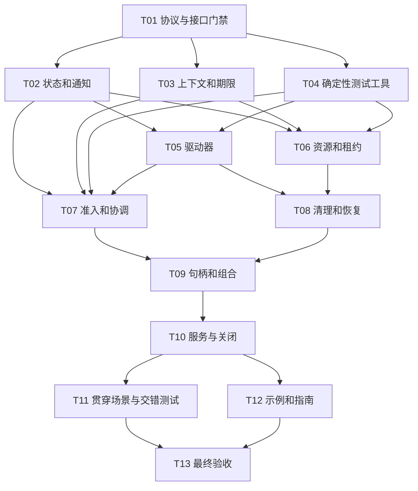

# rs-operation 0.1.0 多智能体协作实施计划

> **历史任务拆解：** 本文中的“空骨架”描述的是该计划编写时的起点，不代表当前仓库状态；历史复选框是原计划的记录，不是当前待办清单，也不得据此自动启动旧计划。当前增量修复见[2026-11-13 评审设计](design-20261113T052055318Z-23ee552e.md)和[配套实施计划](implementation-plan-20261113T052055318Z-23ee552e.md)。原计划验收状态和其设计承诺与当前实现的差异未逐项核对；当前公开接口以源码和已验证的 API 文档为准。

> **面向智能体执行者：** 使用 `subagent-driven-development` 协调多个 subagent，按本文依赖图实施；无法启动 subagent 时使用 `executing-plans` 按相同门禁顺序执行并记录原因。各步骤使用复选框（`- [ ]`）跟踪。本文件是实施方案，本次生成文档不代表已开始实施。

**目标：** 将 `qubit-operation 0.1.0` 空骨架实现为支持同步/异步观察、受管理子操作、资源租约、清理恢复及有界后台收尾的基础库。

**架构：** 一套状态机负责业务结果和资源终结，应用显式持有 supervisor。可移植驱动器和领域执行器通过非阻塞控制协议接入；子操作、资源及恢复责任有唯一 owner，领域语义留在下游。

**技术栈：** Rust edition 2024，`rust-version = "1.94"`，仓库工具链 `1.94.0`；核心基于 std 的 Future/Waker、Mutex/Condvar、Instant 和有界存储。具体运行时只可作测试适配或后续独立集成。

**设计依据：** [0.1.0 设计](design-0.1.0.zh_CN.md)，2026-11-12 综合评审修订版。设计是行为规范，本计划是任务分解。执行前记录设计文件 SHA-256；若发现冲突，主 agent 先同步修订契约和受影响任务，禁止 worker 自行改变语义。

**保存位置：** 按用户要求保存在仓库 `doc/implementation-plan-0.1.0.zh_CN.md`，覆盖技能默认的临时计划位置。执行日志、测试输出、评审记录放在执行时创建的独立临时工作区，不把机器相关绝对路径写进公共 API。

## 1. 基线与全局约束

- 当前 `src/lib.rs` 仅有骨架说明，没有公共 API；`Cargo.toml` 无运行时依赖，`default = []`。不能把设计伪代码当作已存在接口。
- 适用范围为单进程、owned、`Send + 'static` 的托管工作；不引入分布式恢复、自动业务重试/补偿、任意强杀、借用 scope 或业务 DAG DSL。
- 不增加 progress feature、进度接口、事件总线适配，也不依赖 qubit-progress / qubit-event-bus。
- 同步/异步观察同一作业；不重复执行。result 单次取值，released 重复观察；停止、结果和释放分别记录。
- Drop 不 join、不执行 I/O、不执行任意用户 cleanup；在内部锁外 poll 用户 Future、调用适配器、唤醒和析构用户值。普通用户析构须遵守非阻塞约定。
- reserve → attach → commit 先纳管后副作用；取消先被接受则不能 commit。登记失败归还输入/owner。
- 失败保留主因、次级错误、部分副作用和恢复 owner；Unknown/Unconfirmed 不能改写成成功或已释放。
- 核心不直接依赖 command/local-files/fs/mime/magika；本计划仅修改 rs-operation。正式下游迁移、发布 crates.io、推送及分支同步不在本计划默认执行范围。
- 不直接修改 `.infra/**`；基础设施缺陷另到其上游修复。以实际 CI 矩阵为平台要求，不凭本机通过宣称跨平台通过。
- 每个行为任务先写回归、运行得到预期失败，再实现并取得通过证据。RED 可以是缺失本任务 API 的编译错误，但交付必须执行并通过真实行为断言。
- 具体 API 摘要在 T01 固定；不能为了满足接口编译而交付 `todo!()`、`unimplemented!()`、空成功或虚假 Released。

默认容量照设计：活动 root 4、排队 root 64、受理等待者 64、每 root 子操作 64、资源 128、清理并发 4、诊断事件 256、未取结果槽 64。结果槽在受理前预留，因此这些上限不能相加为独立容量保证。嵌套 scope 从父配额切分，服务资源配额单列。

## 2. 主 agent 的协调协议

### 2.1 开工准备

- [ ] 阅读设计全部 23 节、当前仓库约定及本计划；检查 `git status --short --untracked-files=all`、当前分支、实际仓库根目录。现有未跟踪设计不得丢弃或覆盖。
- [ ] 创建独立集成 worktree；每个实现 worker 使用从已解锁集成提交创建的独立 worktree/任务分支，不在用户工作区并发改文件。使用 `using-git-worktrees`，遵守已有分支命名约定。
- [ ] 记录设计哈希、基线提交、工具链、任务分支、写入集合和临时证据目录。执行者以实际路径填写运行台账，不预填虚构提交号。
- [ ] 建立任务台账。字段：任务 ID、状态、依赖提交、worker、worktree、允许写入路径、RED/GREEN 命令及退出码、实现提交、评审问题、集成提交、下一门禁。
- [ ] 预留协调者和审查者槽位。按实际并发上限调度；若总共 4 槽，通常主 agent + 2 实现 worker + 1 reviewer。队列就绪任务不能因等待最终全量测试而串行。

### 2.2 调度与交付

状态依次为 `READY → RUNNING → GREEN → COMMITTED → REVIEWED → INTEGRATED`；另有 `BLOCKED` 和 `REWORK`。前置任务最小可用产物已编译、提交并通过接口门禁，且运行任务写入集合不相交，才能派发。

主 agent 独占集成分支及公共装配文件 `src/lib.rs`、`Cargo.toml`、`Cargo.lock`。叶子 worker 需要新增导出/依赖时，在交付报告列出补丁要求，由主 agent 在接口检查点一次性更新；不得多个 worker 同时 cherry-pick 彼此分支。T01 预登记全部后续模块，空模块只表示尚未实现，不导出占位行为。

每个 worker 使用独立 `CARGO_TARGET_DIR`；重型命令共享缓存时串行，避免把 Cargo 文件锁等待误判为实现停滞。全量测试、Clippy、Rustdoc、coverage 和完整 CI 统一归 T13。叶子只运行本任务 focused tests；失败后的修复可重跑受影响检查并记录原因。

API、共享基础设施、资源所有权、状态机及集成任务立即审查；示例/文档叶子可批量审查。reviewer 只读提交和证据，不直接写实现分支；发现严重/重要问题交回原 worker 修复。主 agent 检查最终 diff 和测试输出，不凭 worker 的“已完成”结论放行。

实现者在 RED、首次编译、GREEN、阻塞和提交时主动汇报。主 agent 保持简短进度更新，工作期间不超过 60 秒沉默；有工具长任务时使用可恢复的短等待。遇到两次无进展先核实命令、最近输出及依赖，再拆小任务或替换 worker，不无限重试同一失败。

### 2.3 派发提示模板

```text
任务：<从本文复制完整任务 ID、正文及验收断言>
基线：<集成提交>；设计：doc/design-0.1.0.zh_CN.md，哈希 <实际值>
工作区：<独立 worktree>；分支：<任务分支>
允许写入：<任务表的精确集合>；共享装配文件由主 agent 修改。
输入契约：<T01 契约摘录及前序产物提交>；不得自行更名或增加行为。
先给出 RED 证据，再实现，再运行 focused command；不运行全量 CI。
不修改其他任务目录，不迁移下游，不发布、不推送。
每个状态转换主动报告；阻塞时说明缺失接口、最小复现和建议修改。
返回：提交 SHA、变更文件、测试命令/退出码、断言证据、风险、装配请求。
```

### 2.4 审查与故障处理

- 基线缺接口：停止受影响派发，由 T01 的接口 owner 修正契约及编译探针；其他独立任务继续。
- 发生文件冲突：主 agent 比较双方意图后解决；不得选择整侧覆盖。更改写入集合前重新检查正在运行任务。
- 行为回归：先保留闸门/假时钟复现，退回对应任务修复；不把失败测试删除或改成仅检查实现细节。
- 永久挂起测试：测试 watchdog 只负责报失败，不能当作已释放证据；保存线程/任务/租约快照后修复协议。
- 需要改设计：先记录冲突、影响的任务和替代方案，在设计/契约内明确决策；超出当前目标或授权范围才向用户询问。

## 3. 文件组织及写入所有权

以下路径均相对 rs-operation 根目录；属于拟新增文件，不代表现在已经存在。

| 路径 | 职责与 owner |
| --- | --- |
| `src/lib.rs`、`Cargo.toml`、`Cargo.lock` | 主 agent 装配、导出与依赖；T01/T12/T13 检查点 |
| `src/report.rs`、`src/report/`、`src/protocol.rs`、`src/protocol/` | T01：ID、报告、错误、跨模块协议 |
| `src/internal.rs`、`src/internal/mod.rs` | 仅选择一种模块入口；T01 建立，主 agent 维护子模块声明 |
| `src/internal/state.rs`、`src/internal/notify.rs` | T02：结果/终结状态单元与通知 |
| `src/context.rs`、`src/context/` | T03：取消树、期限、时钟、预算租约引用 |
| `tests/support/mod.rs`、`tests/support/` | T04：确定性假驱动器、闸门、计数器与测试 fixture |
| `src/driver.rs`、`src/driver/` | T05：PortableDriver、ExternalDriver 协议适配、ThreadExecutor |
| `src/resource.rs`、`src/resource/` | T06/T08 顺序拥有：资源登记、租约、清理与恢复 |
| `src/supervisor.rs`、`src/supervisor/` | T07/T10 顺序拥有：受理、协调、服务组与关闭 |
| `src/operation.rs`、`src/operation/`、`src/scope.rs`、`src/scope/` | T09：公共句柄、子操作登记与组合 |
| `tests/contract_*.rs` | 各任务单独文件，T13 汇总验证 |
| `examples/`、`doc/user_guide.zh_CN.md`、`doc/adapter-guide.zh_CN.md`、双语 README | T12：真实可运行示例、用户/适配器文档 |
| `doc/verification-0.1.0.zh_CN.md` | T13：最终证据、平台与性能记录 |

不要同时创建 `src/internal.rs` 和 `src/internal/mod.rs`；此处两种入口供主 agent 在 T01 按仓库风格选定，台账记录实际选择。后续任务内部按责任拆分文件，禁止通过一个巨型锁把所有公开接口写进单文件。

## 4. 调度图

表中每个任务的命令在第 7 节给出；“最小产物”表示可解锁提交，不等于整个项目已经可运行。任务内出现跨模块集成断言时，由指定后续任务运行，不要求叶子提前构造完整 supervisor。

| 任务 | 前置任务 | 最小解锁产物 | 写入集合 | 本地验证 | 集成验证归属 | 审查时机/批次 |
| --- | --- | --- | --- | --- | --- | --- |
| T01 | 无 | 编译通过的协议类型、模块声明和接口契约 | report/protocol、主装配、`doc/implementation-contract-0.1.0.zh_CN.md`、`tests/contract_api.rs` | API 编译探针 | T13 | 立即；A |
| T02 | T01 | StateCell 与双模式通知 | internal state/notify（模块内测试） | state | T11/T13 | 立即；B |
| T03 | T01 | 取消树、ClockSource、Deadline | context、`tests/contract_context.rs` | context | T11/T13 | 立即；B |
| T04 | T01 | Gate、ManualClock、假 control/driver | tests/support、`tests/contract_support.rs` | support | T11/T13 | 立即；B |
| T05 | T02,T04 | 可运行驱动与阻塞执行器 | driver、`tests/contract_driver.rs` | driver | T11/T13 | 立即；C |
| T06 | T02,T03,T04 | 租约状态机与无环资源图 | resource、`tests/contract_resource.rs` | resource | T11/T13 | 立即；C |
| T07 | T02,T03,T04,T05 | 有界受理与协调端口 | supervisor、`tests/contract_admission.rs` | admission | T11/T13 | 立即；D，可与 T08 并行 |
| T08 | T05,T06 | cleanup/recovery 调度与恢复组 | resource、`tests/contract_cleanup.rs` | cleanup | T11/T13 | 立即；D，可与 T07 并行 |
| T09 | T07,T08 | 完整 handle、子 scope、结果策略 | operation/scope、`tests/contract_scope.rs` | scope | T11/T13 | 立即；E |
| T10 | T09 | 服务受理组、长期资源、关闭 | supervisor、`tests/contract_shutdown.rs` | shutdown | T11/T13 | 立即；F |
| T11 | T10 | 两条贯穿链及故障矩阵 | `tests/contract_pipeline.rs`、`tests/contract_inference.rs`、`tests/contract_interleavings.rs` | 三个集成目标 | T13 | 立即；G，可与 T12 并行 |
| T12 | T10 | 可运行示例与用户/适配说明 | examples、用户文档、README、主装配 | examples 编译和文档示例 | T13 | 批量；G，可与 T11 并行 |
| T13 | T11,T12 | 全量验收与独立整分支审查 | verification 报告、必要 CI 装配 | 全套唯一 owner | 本任务 | 立即；H |

T02/T03/T04 就绪后同批派发，槽位不足则保留 READY 队列；T05/T06 同理。T07 与 T08 不共享写入，必须允许重叠执行；T09 依赖两者的编译提交。资源组：每 worker 自有 target；T13 独占最终集成 target 与重型 CI，不与叶子争抢。

## 5. 任务拓扑依赖图



## 6. 先固定的模块接口和状态裁决

T01 必须将本节细化为可编译的公共协议及内部端口，记录在 `doc/implementation-contract-0.1.0.zh_CN.md`，并立即审查。以下是目标边界，不是现有代码。

```rust,ignore
trait ManagedOperationControl: Send + Sync {
    fn request_stop(&self, reason: StopReason);
    fn snapshot(&self) -> ChildSnapshot;
    fn poll_business(&self, cx: &mut Context<'_>) -> Poll<ChildBusinessSummary>;
    fn poll_released(&self, cx: &mut Context<'_>) -> Poll<ChildSettlement>;
}
trait ClockSource: Send + Sync {
    fn now(&self) -> MonotonicTime;
    fn register_deadline(&self, at: MonotonicTime, wake: Waker) -> TimerRegistration;
}
trait OwnedCleanup: Send + 'static {
    fn begin(self: Box<Self>, context: CleanupContext)
        -> Pin<Box<dyn Future<Output = CleanupOutcome> + Send + 'static>>;
}
```

上述类型由 T01 定义：`MonotonicTime` 携带 clock-domain ID 和域内单调 tick，Deadline 只能与同域值比较；`TimerRegistration` 的取消不会误删新一代定时器。`CleanupOutcome` 为 Cleaned、Transferred(TransferReceipt)、FailedWithRecovery(CleanupFailure, RecoveryOwner)。`RecoveryOwner` 是不透明 owned 容器，类型化恢复 key 单次提取；observer 不获得 downcast 权限。报告重复观察用不可变共享快照，typed source 可以 Arc 共享，不能要求任意 E 实现 Clone。

`OperationOutcome<T,E>` 的目标变体为 Succeeded(T)、Failed(E)、ChildFailed(ChildFailureSummary)、Stopped(StopReport)、Panicked(PanicSummary)。`StartError<F>` 包含 AdmissionError 与 F；不把跨子操作错误强转为父 E。

跨模块端口分为四类：

1. 状态端口：提交业务结果、请求停止、发布终结、登记等待者；只修改内部事实，返回待唤醒/待析构对象给锁外执行。
2. 驱动端口：提交 owned Future/阻塞闭包，返回受管理 task control 与驱动存活 lease；失败归还未启动输入，已启动失败进入 operation。
3. scope 端口：reserve_child、attach、commit，子配额切分，resource 登记及 acquire_use；commit 是唯一副作用启动授权点，不在锁内调用外部 executor。
4. 清理端口：取得已关闭新使用且租约为零的 ready owner，返回终结/恢复事实。T08 不反向调用尚未存在的 supervisor；T07 注入这些窄端口，T09 负责完整装配。

以下设计缝隙必须在 T01 明确并编译验证，然后才能启动依赖任务：

- `reserve_child(options)` 的 required/optional、启动许可的单次消费、attach 后未 commit Drop 的撤销和领域许可归还责任。
- `OperationScope` 的 clone/授权传播：body 关闭只关闭自身提交权；已 commit 子 scope 的授权按设计继续有效，不能凭残留 clone 绕过关闭。
- 清理 Future panic 时 owner 的去向：恢复能力由注册表保留的独立 recovery capsule 提供，不能全部移动进可能 unwind 的 Future。适配器无法提供 capsule 则不能声称失败后可恢复。
- `released()` 返回不可变终结快照；`released_blocking()` 返回 `Result<SettlementReport, ObservationError>` 以表达 WouldDeadlock。`observe_until` 的 deadline 是观察期限，返回快照和可继续观察的 observer。
- released 为历史结算报告；后续 retry/keep/take_recovery 通过恢复注册表的新快照观察，不回写已经交付的终结事实。恢复 owner 的配额及服务保活责任直到明确转交才归还。
- 服务受理组与服务资源 scope 的 public 名称、创建错误和有限配额；服务 group 无活动 root 许可，资源 scope 不能变相无限登记业务任务。
- observer/ID、终结报告、取消附加原因、EffectRecord、依赖边和服务组的存储也须有上限。活 observer 由调用方承担内存，supervisor 仅保留有限索引；回收 ID 查询返回明确 NotFound，已持 observer 仍能观察其共享终结快照。使用代际 ID 防止旧 key 命中新对象。

这些决策是把设计落成可执行契约的前置工作，不允许通过删去恢复、服务组或 Unconfirmed 功能绕开。

## 7. 详细实施任务

每个任务步骤是一次测试/实现/检查/提交动作；任务较大时按列出的断言逐个进行 RED→GREEN，不一次性写完全部逻辑。代码示例里的 `assert_trace` 是 T04 提供的测试 fixture 入口，它执行真实模块动作并采集可比较事实，不能直接返回预设期待值。相应案例必须在该任务实现其真实驱动分支。

### T01：协议类型、接口编译门禁

**前置任务：** 无。**文件/写入集合：** src/report.rs、src/report/、src/protocol.rs、src/protocol/、src/lib.rs、src/internal/mod.rs、Cargo.toml、Cargo.lock、doc/implementation-contract-0.1.0.zh_CN.md、tests/contract_api.rs。

**输入接口：** 设计第 6—20 节；当前空骨架。

**输出接口：** 公开 ID、错误、不可变报告及第 6 节三个 trait；内部端口用 crate 可见性封装。完整 start/handle/服务接口签名记录在契约中，按后续任务逐步实现；此时不提供假实现。

**审查与调度：** 遵循第 4 节；除 T12 的独立文档外立即审查，最终全量归 T13；不扩大写入集合。

- [ ] 将下列验收断言写入本任务测试目标，先运行 focused command，保留预期失败证据。

  - trait 对象编译通过；非 Send/非静态借用输入的 compile_fail 文档例不能通过编译。
  - StartError 可以取回原 F；RecoveryKey 与资源代际关联；不安全类型擦除不得暴露任意 downcast。

- [ ] 先定义状态/结果/清理枚举、配额与代际 ID，固定未知事实和错误来源；分别记录每类 owner 的移交点。
- [ ] 确定 Driver、BlockingExecutor 和各窄端口的确切参数、返回值、对象安全约束及恢复 capsule 机制；写入契约文档并给后续 worker 摘录。
- [ ] 使用空实现测试类型证明 ManagedOperationControl、ClockSource、OwnedCleanup 可以形成 trait object；用不实现 Clone 的错误类型证明报告/结果不要求 E: Clone。
- [ ] 以最小类型实现使 API 测试通过；主 agent 建立模块声明，后续目录禁止导出未实现行为。

**关键断言/调用形态：** 下列代码用于落实上述场景，测试变量必须由真实作业、计数器或报告取得，不能手填期待值。

```rust,ignore
pub fn assert_object_safe(_: &dyn ManagedOperationControl) {}
```

- [ ] 运行本地验证：

```bash
cargo test --test contract_api
```

预期：退出码 0，编译探针与对象安全检查通过，无占位成功路径。T01 的 compile_fail 例在 T13 文档测试统一执行。

- [ ] 提交仅本任务允许文件，返回 SHA、RED/GREEN 证据及装配请求；主 agent 在集成分支合入并更新台账。

建议英文提交信息：`feat: define lifecycle contracts`。

### T02：结果状态单元和通知

**前置任务：** T01。**文件/写入集合：** src/internal/state.rs、src/internal/notify.rs。

**输入接口：** T01 的 ID、错误和状态协议。

**输出接口：** 内部 StateCell/通知端口：单次结果槽、稳定终结快照、同步/异步等待者；不依赖 supervisor 或资源实现。

**审查与调度：** 遵循第 4 节；除 T12 的独立文档外立即审查，最终全量归 T13；不扩大写入集合。

- [ ] 将下列验收断言写入本任务测试目标，先运行 focused command，保留预期失败证据。

  - 先完成后等待、先登记后完成、登记与完成交错均不丢唤醒。
  - 等待 Future Drop 后再等待仍可取同一个非 Clone T；第二次取值 AlreadyTaken。
  - 取消/成功竞态分别控制先后，已发布事实不翻转；多个 observer 不互相覆盖 Waker。

- [ ] 先实现测试局部的计数 Waker 和 Condvar 闸门，不依赖尚未完成的 T04。
- [ ] 将结果槽建模为 Pending/Ready/Taken/Discarded；同一互斥状态内完成结果与停止裁决，返回待唤醒列表供锁外执行。
- [ ] 等待采用读状态—登记—复查协议；异步等待 Future Drop 注销自身 waiter，不能拿走 T。
- [ ] 在发布后唤醒同步/异步等待者；稳定报告共享，用户结果和旧 Waker 均在内部锁外释放。

**关键断言/调用形态：** 下列代码用于落实上述场景，测试变量必须由真实作业、计数器或报告取得，不能手填期待值。

```rust,ignore
assert_eq!(wake_count.load(Ordering::SeqCst), 1);
```

- [ ] 运行本地验证：

```bash
cargo test --lib internal::state
cargo test --lib internal::notify
```

预期：退出码 0，全部状态转换和通知交错断言通过。T01 的 compile_fail 例在 T13 文档测试统一执行。

- [ ] 提交仅本任务允许文件，返回 SHA、RED/GREEN 证据及装配请求；主 agent 在集成分支合入并更新台账。

建议英文提交信息：`feat: add operation state and notifications`。

### T03：取消树、单调期限和上下文

**前置任务：** T01。**文件/写入集合：** src/context.rs、src/context/、tests/contract_context.rs。

**输入接口：** T01 的 ClockSource、时间域、ID 和停止原因。

**输出接口：** OperationContext、取消子树、Deadline 收紧、ClockSource 实际实现；定时通知不依赖外部 runtime。

**审查与调度：** 遵循第 4 节；除 T12 的独立文档外立即审查，最终全量归 T13；不扩大写入集合。

- [ ] 将下列验收断言写入本任务测试目标，先运行 focused command，保留预期失败证据。

  - 父取消传播全部后代；子取消不自动取消兄弟。
  - 期限同域可比、跨域拒绝；到期前后提交得到确定不同结果。
  - 取消/定时器重复触发幂等，完成后的定时器可回收，清理 context 不继承已取消业务 token。

- [ ] 以任务局部 ManualClock 测试域校验和总期限；T04 完成后只把共用工具迁入 support，不反向增加依赖。
- [ ] 使用父到子的弱索引或显式注销防止无限取消树；第一次停止原因为主因，后续原因走有限摘要。
- [ ] 子期限取父/子较早值，排队不重置时钟；定时器到点唤醒协调端口。
- [ ] 预算只持租约/摘要，不实现字节总账；测试共享引用不重复计费且复制由领域重新申请。

**关键断言/调用形态：** 下列代码用于落实上述场景，测试变量必须由真实作业、计数器或报告取得，不能手填期待值。

```rust,ignore
assert!(child_deadline <= parent_deadline);
```

- [ ] 运行本地验证：

```bash
cargo test --test contract_context
```

预期：退出码 0，假时钟推进触发真实通知，无 sleep。T01 的 compile_fail 例在 T13 文档测试统一执行。

- [ ] 提交仅本任务允许文件，返回 SHA、RED/GREEN 证据及装配请求；主 agent 在集成分支合入并更新台账。

建议英文提交信息：`feat: add cancellation contexts and deadlines`。

### T04：确定性测试基础设施

**前置任务：** T01。**文件/写入集合：** tests/support/mod.rs、tests/support/、tests/contract_support.rs。

**输入接口：** T01 公共控制/时间/清理协议。

**输出接口：** Gate、ManualClock、CountingWaker、FakeControl、FakeCleanup、DropProbe、ManualDriver；各有明确事件计数和释放闸门。

**审查与调度：** 遵循第 4 节；除 T12 的独立文档外立即审查，最终全量归 T13；不扩大写入集合。

- [ ] 将下列验收断言写入本任务测试目标，先运行 focused command，保留预期失败证据。

  - 未打开 gate 时真实 poll 为 Pending，打开后才 Ready。
  - 业务完成闸门不自动打开释放闸门；多次停止不重复释放。
  - 测试工具不使用 sleep 安排先后、不依赖真实命令/网络/模型。

- [ ] Gate 用 Mutex/Condvar 或 Waker 实现 started/release 两个明确事件，wait 必须带测试失败 watchdog。
- [ ] FakeControl 分别保存业务和释放两组状态/Waker，允许先结果后释放，request_stop 仅计数并置位。
- [ ] FakeCleanup 支持成功、恢复、panic、挂起四个受控分支；DropProbe/permit 统计真实对象存活和析构次数。
- [ ] ManualDriver 只在测试显式推进时 poll，记录 poll/唤醒次数；工具自测验证它能暴露丢通知和重复释放。

**关键断言/调用形态：** 下列代码用于落实上述场景，测试变量必须由真实作业、计数器或报告取得，不能手填期待值。

```rust,ignore
assert_eq!(control.stop_requests(), 1);
```

- [ ] 运行本地验证：

```bash
cargo test --test contract_support
```

预期：退出码 0，fixture 自测证明闸门和计数有效。T01 的 compile_fail 例在 T13 文档测试统一执行。

- [ ] 提交仅本任务允许文件，返回 SHA、RED/GREEN 证据及装配请求；主 agent 在集成分支合入并更新台账。

建议英文提交信息：`test: add deterministic lifecycle test fixtures`。

### T05：可移植驱动与阻塞执行器

**前置任务：** T02,T04。**文件/写入集合：** src/driver.rs、src/driver/、tests/contract_driver.rs。

**输入接口：** T02 状态/通知端口；T04 可控 Future、计数 Waker。

**输出接口：** PortableDriver、Driver task control/lease、ExternalDriver 接口测试适配、固定容量 ThreadExecutor。

**审查与调度：** 遵循第 4 节；除 T12 的独立文档外立即审查，最终全量归 T13；不扩大写入集合。

- [ ] 将下列验收断言写入本任务测试目标，先运行 focused command，保留预期失败证据。

  - 排队 64 项不增加 64 个线程；worker 峰值等于配置上限。
  - 持续自唤醒任务不能饿死停止；标准 Future 可执行，绑定 runtime 的 Future 不自动送 PortableDriver。
  - ExternalDriver 丢失返回 DriverLost/Unconfirmed，不能报告 Released。

- [ ] 写 ready 队列满、重复 wake、自唤醒和驱动丢失测试，使用预登记任务槽与 ready 标志。
- [ ] 实现有界队列：重复唤醒合并，队满使用可重扫标志/登记项保证不丢唤醒，控制信号走独立路径。
- [ ] 每轮 poll 设置预算，控制/期限/清理有推进机会；Future 在取出内部锁后 poll。
- [ ] 阻塞 executor 固定 worker 数与队列上限；线程本地标记服务身份；外部 driver 失活保留未确认状态和 owner，不跨线程搬迁绑定任务。

**关键断言/调用形态：** 下列代码用于落实上述场景，测试变量必须由真实作业、计数器或报告取得，不能手填期待值。

```rust,ignore
assert!(peak_workers.load(Ordering::SeqCst) <= configured_workers);
```

- [ ] 运行本地验证：

```bash
cargo test --test contract_driver
```

预期：退出码 0，驱动公平性、容量和失活契约通过。T01 的 compile_fail 例在 T13 文档测试统一执行。

- [ ] 提交仅本任务允许文件，返回 SHA、RED/GREEN 证据及装配请求；主 agent 在集成分支合入并更新台账。

建议英文提交信息：`feat: add portable task drivers`。

### T06：资源登记、使用租约和依赖图

**前置任务：** T02,T03,T04。**文件/写入集合：** src/resource.rs、src/resource/、tests/contract_resource.rs。

**输入接口：** T01 资源协议；T02 通知；T03 context；T04 计数 owner。

**输出接口：** 资源 registry、ResourceUse、资源关闭、无环 cleanup 图、原子 promote/transfer；仅产出可清理 owner，不执行清理。

**审查与调度：** 遵循第 4 节；除 T12 的独立文档外立即审查，最终全量归 T13；不扩大写入集合。

- [ ] 将下列验收断言写入本任务测试目标，先运行 focused command，保留预期失败证据。

  - 最后一个租约归还前 ready_cleanup 不能取得 owner。
  - 自环、环路、独立 root 或跨 supervisor 依赖失败并归还新 owner。
  - CloseForUse 后 acquire 必须失败；失败转交仍可通过原 handle 查询资源。

- [ ] 先测 register/close/acquire 竞争、多租约、环路和失败归还 owner。
- [ ] 登记槽先于创建；owner 只移动一次。ResourceUse 非 Clone，Drop 仅归还计数和唤醒。
- [ ] 新增边先验证同域/作用域权限及无环，再提交；图方向 B → A 表示 B 完成才能清理 A。
- [ ] transfer 先预留目标配额，再原子转移登记、租约授权和依赖归属；失败不破坏原登记。

**关键断言/调用形态：** 下列代码用于落实上述场景，测试变量必须由真实作业、计数器或报告取得，不能手填期待值。

```rust,ignore
assert_eq!(owner_drop_count.load(Ordering::SeqCst), 0);
```

- [ ] 运行本地验证：

```bash
cargo test --test contract_resource
```

预期：退出码 0，所有权与图校验通过，尚未清理不能析构 owner。T01 的 compile_fail 例在 T13 文档测试统一执行。

- [ ] 提交仅本任务允许文件，返回 SHA、RED/GREEN 证据及装配请求；主 agent 在集成分支合入并更新台账。

建议英文提交信息：`feat: add resource leases and dependencies`。

### T07：有界准入、队列和协调循环

**前置任务：** T02,T03,T04,T05。**文件/写入集合：** src/supervisor.rs、src/supervisor/、tests/contract_admission.rs。

**输入接口：** T02 状态；T03 期限；T05 驱动提交/存活端口。

**输出接口：** OperationSupervisor 受理内核、root 配额与结果槽、有限等待队列和协调端口；通过 trait 注入资源/清理端口，不提前依赖 T08。

**审查与调度：** 遵循第 4 节；除 T12 的独立文档外立即审查，最终全量归 T13；不扩大写入集合。

- [ ] 将下列验收断言写入本任务测试目标，先运行 focused command，保留预期失败证据。

  - 队列取消无 body 副作用；等待者超限/关闭/过期分别返回确定 AdmissionError。
  - 业务队列满仍能停止/清理；每项计数在失败回滚与完成后准确归还。
  - StartError 持有的捕获输入与提交前相同，失败后不出现无主任务。

- [ ] 验证结果槽 1 时第二次受理 Busy，取走/放弃首结果才允许下一次受理。
- [ ] 将 root/队列/结果/登记存储预留做成可回滚准入事务；StartError<F> 返回未执行输入。
- [ ] start_wait 注册有限 waiter；等待 future Drop 与受理竞争由同一状态裁决，已受理 work 转入 handle Drop 路径。
- [ ] 协调器只更新状态、驱动任务和接收窄端口事件；结果未取不占已释放执行许可，诊断队满只计丢失数。

**关键断言/调用形态：** 下列代码用于落实上述场景，测试变量必须由真实作业、计数器或报告取得，不能手填期待值。

```rust,ignore
assert_eq!(body_start_count.load(Ordering::SeqCst), 0);
```

- [ ] 运行本地验证：

```bash
cargo test --test contract_admission
```

预期：退出码 0，准入事务、结果预留、等待取消安全通过。T01 的 compile_fail 例在 T13 文档测试统一执行。

- [ ] 提交仅本任务允许文件，返回 SHA、RED/GREEN 证据及装配请求；主 agent 在集成分支合入并更新台账。

建议英文提交信息：`feat: add bounded operation admission`。

### T08：清理调度、恢复注册表与恢复组

**前置任务：** T05,T06。**文件/写入集合：** src/resource.rs、src/resource/、tests/contract_cleanup.rs。

**输入接口：** T06 ready owner/图/租约；T05 驱动；T01 OwnedCleanup 和 recovery capsule。

**输出接口：** 独立清理并发、恢复 owner、RecoveryKey、retry_cleanup/keep/take_recovery、依赖组转交和结算事件端口。

**审查与调度：** 遵循第 4 节；除 T12 的独立文档外立即审查，最终全量归 T13；不扩大写入集合。

- [ ] 将下列验收断言写入本任务测试目标，先运行 focused command，保留预期失败证据。

  - 失败后 owner 可取回恰好一次；错误 key/旧代际/错误类型拒绝且 owner 不丢。
  - B FailedWithRecovery 后 A 的清理调用数为 0；整组转交才结束责任。
  - 业务队列满不占清理槽；cleanup panic 后 recovery capsule 仍可访问。

- [ ] 写业务成功但 cleanup 失败、前置 B 失败阻止 A、单次提取和 cleanup panic 四组回归。
- [ ] 清理不沿用业务 token；按可执行依赖和资源 ID 选取，使用独立并发许可。
- [ ] 失败 owner 与 capsule 进入有限恢复表；阻塞后继形成恢复组，单取前置 owner 不解锁后继。
- [ ] 显式 retry/keep/take 更新恢复快照和配额；报告历史快照不回写。清理期限仅产生 Unconfirmed，不能强 Drop。

**关键断言/调用形态：** 下列代码用于落实上述场景，测试变量必须由真实作业、计数器或报告取得，不能手填期待值。

```rust,ignore
assert_eq!(dependent_cleanup_calls.load(Ordering::SeqCst), 0);
```

- [ ] 运行本地验证：

```bash
cargo test --test contract_cleanup
```

预期：退出码 0，失败、依赖、panic 和恢复配额均有可观察证明。T01 的 compile_fail 例在 T13 文档测试统一执行。

- [ ] 提交仅本任务允许文件，返回 SHA、RED/GREEN 证据及装配请求；主 agent 在集成分支合入并更新台账。

建议英文提交信息：`feat: add cleanup and recovery ownership`。

### T09：公共句柄、子操作协议和作用域组合

**前置任务：** T07,T08。**文件/写入集合：** src/operation.rs、src/operation/、src/scope.rs、src/scope/、tests/contract_scope.rs。

**输入接口：** T07 supervisor 内核；T08 resource/cleanup；T01 typed outcome 和 child control。

**输出接口：** 设计第 8 节 start/start_blocking、handle/observer、reserve/attach/commit、scope.join、FailFast/Collect、run_async/run_to_completion。

**审查与调度：** 遵循第 4 节；除 T12 的独立文档外立即审查，最终全量归 T13；不扩大写入集合。

- [ ] 将下列验收断言写入本任务测试目标，先运行 focused command，保留预期失败证据。

  - 取消先到 commit：启动数 0；commit 先到：控制已登记且收到停止。
  - body Ok 但 required 失败得到 ChildFailed，父 E 不需要 From<子 E>；optional 可由 body fallback。
  - 丢等待 Future 不取消 handle；丢 handle 请求停止，detach 不请求停止；所有 owner 仍有管理者。
  - result 可早于 released；被托管线程调用阻塞等待得到 WouldDeadlock。

- [ ] 先以 FakeControl 验证取消在 commit 前后、required 失败早于 released、结果等待取消与 handle Drop。
- [ ] reserve/attach 不产生副作用；commit 单次线性化并消费启动授权，attach 后撤销归还领域许可。
- [ ] Handle 不 Clone、Observer 可 Clone；result 单次取值，released 稳定重复观察，detach 放弃 typed 结果但继续受 shutdown 管理。
- [ ] 实现 body 与 required 结果聚合；FailFast 停止全部已启动子操作，Collect 保留兄弟运行但禁止 required 失败后成功。
- [ ] join 等待子 scope 释放/转交；正常 body 返回只关闭自身提交权；run_to_completion 的资源型结果要求先转交，测试避免自持租约死锁。

**关键断言/调用形态：** 下列代码用于落实上述场景，测试变量必须由真实作业、计数器或报告取得，不能手填期待值。

```rust,ignore
assert!(matches!(outcome, OperationOutcome::ChildFailed(_)));
```

- [ ] 运行本地验证：

```bash
cargo test --test contract_scope
```

预期：退出码 0，完整公共操作生命周期和组合规则通过。T01 的 compile_fail 例在 T13 文档测试统一执行。

- [ ] 提交仅本任务允许文件，返回 SHA、RED/GREEN 证据及装配请求；主 agent 在集成分支合入并更新台账。

建议英文提交信息：`feat: add managed scopes and operation handles`。

### T10：服务组、长期资源与关闭保活

**前置任务：** T09。**文件/写入集合：** src/supervisor.rs、src/supervisor/、tests/contract_shutdown.rs。

**输入接口：** T09 完整 scope/handle；T08 recovery；T05 driver lease。

**输出接口：** 服务受理组/服务资源 scope、shutdown_async/shutdown_blocking、Drain/Cancel、超期观察和后台存活管理。

**审查与调度：** 遵循第 4 节；除 T12 的独立文档外立即审查，最终全量归 T13；不扩大写入集合。

- [ ] 将下列验收断言写入本任务测试目标，先运行 focused command，保留预期失败证据。

  - 一个服务组关闭不关闭共享 supervisor；父 required 策略仍能传播真实失败。
  - shutdown 超期不销毁 native/features/临时资源；解除 gate 后最终完成。
  - 公共 clone 全部 Drop 后最终 worker 退出；仅持 observer 不阻止 Cancel。
  - 恢复 owner 未处理时 shutdown 报明恢复责任，不能错误宣称全部释放。

- [ ] 先测长期服务执行多于 64 个依次释放的请求，确认不耗尽永久 root 子操作配额。
- [ ] 服务组关闭与 commit 串行；只控制该服务登记工作，不直接取消同父其他服务。长期资源独立有限配额。
- [ ] Drain 关闭新 root 但允许既有 root 展开工作；Cancel 禁止新 commit；并发 shutdown 共享状态且仅允许 Drain 升级 Cancel。
- [ ] 最后公共 supervisor handle Drop 发 Cancel；内部 lease 不计公共 handle，消除 worker Arc 永久环；活动/recovery 未移交前保留责任。
- [ ] 观察超期返回 pending 清单和 observer，随后可再次等待；外部 driver/runtime 关闭次序在错误报告中可见。

**关键断言/调用形态：** 下列代码用于落实上述场景，测试变量必须由真实作业、计数器或报告取得，不能手填期待值。

```rust,ignore
assert_eq!(active_root_permits_for_service_group, 0);
```

- [ ] 运行本地验证：

```bash
cargo test --test contract_shutdown
```

预期：退出码 0，服务隔离、关闭竞态和保活计数通过。T01 的 compile_fail 例在 T13 文档测试统一执行。

- [ ] 提交仅本任务允许文件，返回 SHA、RED/GREEN 证据及装配请求；主 agent 在集成分支合入并更新台账。

建议英文提交信息：`feat: add service groups and shutdown`。

### T11：跨模块贯穿场景和确定性交错

**前置任务：** T10。**文件/写入集合：** tests/contract_pipeline.rs、tests/contract_inference.rs、tests/contract_interleavings.rs。

**输入接口：** T10 已装配公共 API 与全部测试 fixture。

**输出接口：** 两个独立领域适配器的集成证据、全部设计验证矩阵交错用例；不引入真实下游依赖。

**审查与调度：** 遵循第 4 节；除 T12 的独立文档外立即审查，最终全量归 T13；不扩大写入集合。

- [ ] 将下列验收断言写入本任务测试目标，先运行 focused command，保留预期失败证据。

  - 正常路径、每阶段取消、部分副作用、双错误、Unconfirmed 后继续观察全部可复现。
  - 业务失败与清理失败并存，主错误未覆盖；停止不能提前释放 native 输入。
  - 计数最终归零或明确停在 recovery，不存在无主 owner 或重复清理。

- [ ] 假文件+假命令+假上传链：在转换 helper gate 打开前输入 owner 必须存活；上传已提交再取消保留 EffectRecord。
- [ ] 假采样+假 native worker 链：业务可停止，但 features/session 许可在 native gate 打开前不能释放。
- [ ] 模拟 facade 包装既有领域 control，透传同一登记/租约，断言 owner 只登记/清理一次。
- [ ] 枚举 commit/cancel、结果/停止、waiter/完成、最后租约/close 的可控交错；设置固定种子压力重复用于补充，不替代确定性用例。
- [ ] 故障注入涵盖 cleanup/driver/body panic、恢复提取、结果背压、服务组关闭；模型检查只对小状态核心使用 dev-only 工具。

**关键断言/调用形态：** 下列代码用于落实上述场景，测试变量必须由真实作业、计数器或报告取得，不能手填期待值。

```rust,ignore
assert_eq!(resource_cleanup_count.load(Ordering::SeqCst), 1);
```

- [ ] 运行本地验证：

```bash
cargo test --test contract_pipeline
cargo test --test contract_inference
cargo test --test contract_interleavings
```

预期：退出码 0，三套跨模块契约测试通过并保留故障轨迹。T01 的 compile_fail 例在 T13 文档测试统一执行。

- [ ] 提交仅本任务允许文件，返回 SHA、RED/GREEN 证据及装配请求；主 agent 在集成分支合入并更新台账。

建议英文提交信息：`test: test managed operation pipelines`。

### T12：示例、用户指南及适配说明

**前置任务：** T10。**文件/写入集合：** examples/sync_pipeline.rs、examples/async_pipeline.rs、examples/inference_cancel.rs、doc/user_guide.zh_CN.md、doc/adapter-guide.zh_CN.md、README.md、README.zh_CN.md、src/lib.rs。

**输入接口：** T10 公共 API 定稿，设计第 3、4、5、16、20、23 节。

**输出接口：** 无需网络/命令/模型的可运行同步/异步示例、中文完整用户指南、适配器检查表、对齐的双语 README。

**审查与调度：** 遵循第 4 节；除 T12 的独立文档外立即审查，最终全量归 T13；不扩大写入集合。

- [ ] 将下列验收断言写入本任务测试目标，先运行 focused command，保留预期失败证据。

  - cargo check --examples 通过；三个示例正常退出且输出显示真实终结状态。
  - 中文指南包含容量/期限/恢复/Drop 限制与 feature/依赖矩阵。
  - API 链接有效；无进度接口、隐式 runtime 或虚构性能承诺。

- [ ] 示例只使用已实现公开接口；展示 result/released 分离和显式 shutdown，不调用不存在的方法。
- [ ] 用户指南从创建 supervisor、提交、停止、观察、恢复到关闭串成完整路径，包含资源型结果先释放/转交租约。
- [ ] 适配指南解释 reserve/attach/commit、cleanup capsule、线程归属和 facade 单次登记，列出领域接入时所需证据。
- [ ] README 去除空骨架说明，标注实际支持范围；声明未提供正式 Tokio 适配器时不得宣传任意异步 I/O 兼容。
- [ ] 主 agent 更新 lib 导出/Rustdoc 与 Cargo examples 必要装配；编译示例并执行三条演示，输出必须与行为相符。

**关键断言/调用形态：** 下列代码用于落实上述场景，测试变量必须由真实作业、计数器或报告取得，不能手填期待值。

```rust,ignore
let outcome = operation.result_blocking()?;
let settlement = operation.released_blocking()?;
```

- [ ] 运行本地验证：

```bash
cargo check --examples
cargo run --example sync_pipeline
cargo run --example async_pipeline
cargo run --example inference_cancel
```

预期：退出码 0，示例可运行、叙述与公共 API 一致。T01 的 compile_fail 例在 T13 文档测试统一执行。

- [ ] 提交仅本任务允许文件，返回 SHA、RED/GREEN 证据及装配请求；主 agent 在集成分支合入并更新台账。

建议英文提交信息：`docs: document managed operation usage`。

### T13：最终验收、整分支审查和证据归档

**前置任务：** T11,T12。**文件/写入集合：** doc/verification-0.1.0.zh_CN.md；必要的 Cargo/CI 装配由主 agent 独占。

**输入接口：** T11 集成证明；T12 示例文档；所有任务实现提交和审查记录。

**输出接口：** 可复现的核心验收报告、平台证据、性能测量与未解决限制；不自动发布。

**审查与调度：** 遵循第 4 节；除 T12 的独立文档外立即审查，最终全量归 T13；不扩大写入集合。

- [ ] 将下列验收断言写入本任务测试目标，先运行 focused command，保留预期失败证据。

  - 全部核心/集成测试、Clippy、Rustdoc、打包和 CI 必需检查通过。
  - 至少假文件/命令和假推理两类领域协议有集成验收；真实下游迁移仍另行实施。
  - 无未关闭严重/重要审查问题；失败/未确认/未验证平台如实记录。

- [ ] 按第 9 节执行一次完整本地验收，保存命令、工具链、提交和退出码；失败回到责任任务，不降低阈值。
- [ ] 独立 reviewer 审查整个集成 diff，对照设计不变量、公开 API、ownership、Drop/锁边界及下游消费契约，不只审最后一个提交。
- [ ] 检查现有 CI 平台矩阵，在可用 runner 上取证；平台无法验证时明确未验证，不声称跨平台完成。
- [ ] 按第 9 节运行计数和性能测量，记录环境与数值，不以容量计数代替 RSS 测量。
- [ ] 核对第 8 节覆盖表、所有任务台账和审查问题；仅在通过完成条件后改写实施状态。

**关键断言/调用形态：** 下列代码用于落实上述场景，测试变量必须由真实作业、计数器或报告取得，不能手填期待值。

```rust,ignore
assert_eq!(unresolved_critical_or_important_findings, 0);
```

- [ ] 运行本地验证：

```bash
.infra/bin/ci-check.sh
```

预期：退出码 0，通过第 10 节完成门禁，输出实际证据报告。T01 的 compile_fail 例在 T13 文档测试统一执行。

- [ ] 提交仅本任务允许文件，返回 SHA、RED/GREEN 证据及装配请求；主 agent 在集成分支合入并更新台账。

建议英文提交信息：`docs: record operation acceptance evidence`。

## 8. 设计要求到任务的覆盖表

执行者在每行补充实际测试名称和证据路径；没有测试或文档证据不得勾选。此表按设计章节覆盖，验证矩阵的全部行还须逐行写入 T13 报告。

| 设计章节/必须项 | 实现任务 | 验收任务与证据要求 |
| --- | --- | --- |
| 1—2：唯一终结责任、多个操作共享生命周期、错误不覆盖 | T01,T07,T08,T09 | T11 两条链；T13 整体审查 |
| 3：owned/Send 边界及非目标，不做业务补偿/重试 | T01,T09,T12 | T13 compile_fail 和依赖检查 |
| 3.1：不增加进度/事件总线能力 | T01,T12 | T13 检查 Cargo features、导出和指南 |
| 4：下载/暂存/转换/上传，helper 退出前不能删输入 | T06,T08,T09 | T11 pipeline 的正常/失败/取消/发布后取消 |
| 5：采样/native 不可中断推理 | T05,T09,T10 | T11 inference gate 和存活计数 |
| 6.1—6.5：责任、事实分离、真实确认、租约、启动纳管 | T02,T06,T07,T09 | T11 commit 交错、假 helper 未退出 |
| 6.6：Drop 不阻塞、不执行用户清理 | T05,T08,T09,T10 | T11 闸门未释放时 Drop 仍返回；T13 锁边界审查 |
| 6.7—6.10：错误/副作用、控制不丢、有界存储 | T01,T05,T07,T08 | T11 双错误/队列满；T13 容量表 |
| 7：模块分层、std 核心、无循环领域依赖 | T01,T05 | T13 manifest/依赖树和默认 feature 检查 |
| 8：start/start_wait/start_blocking/run_async、单次结果、detach | T07,T09 | T11 首次 poll/等待 Drop/受理竞争 |
| 9：取消树、第一停止原因、总期限、预算引用 | T03,T07 | T11 假时钟、停止/结果竞争 |
| 10：业务/资源双状态、ChildFailed、稳定终结、observe_until | T02,T08,T09 | T11 先失败/停止，后到真实释放；历史报告不变 |
| 11：业务/释放两路 poll、Waker、reserve/attach/commit、Legacy 拒绝 | T01,T05,T09 | T11 启动竞态，无主工作计数为零 |
| 12：资源槽、CloseForUse、多租约、图、promote/transfer | T06,T09 | T11 最后使用者、环路、跨 root 拒绝和失败归还 |
| 12：结果访问 handle 不得自持租约等待清理 | T09,T12 | T11 转交/归还后 released；指南警示 |
| 13：cleanup 独立 token、失败 recovery、依赖组、单次提取 | T08 | T11 cleanup panic/失败、错误 key、超期继续持有 |
| 14：FailFast/Collect、required/optional、join 真实终结 | T09 | T11 required 早失败、optional fallback、异构 E |
| 15：Portable/ExternalDriver、固定 worker、每轮预算、非阻塞 poll | T05 | T11 驱动丢失/自唤醒；T13 线程峰值 |
| 16：同状态的同步/异步通知、WouldDeadlock、无静态借用逃逸 | T02,T05,T09 | T11 对等结果；T13 compile_fail |
| 17：handle/observer/supervisor Drop、detach、Drain/Cancel、后台保活 | T09,T10 | T11 关闭超期、再次观察、worker 最终退出 |
| 18：默认容量、结果槽预留、配额切分、恢复占位、清理预留 | T06,T07,T08,T10 | T11 满队列与嵌套；T13 容量压力 |
| 19：类型化 source、PanicSummary、EffectRecord、有限脱敏诊断 | T01,T07,T08,T09 | T11 unwind/诊断溢出；T13 报告敏感信息审查 |
| 20：五库统一协议、服务组/长期资源、facade 单次登记 | T01,T09,T10,T12 | T11 假 facade 链；T13 下游适配契约核对 |
| 21：按协议→驱动→资源→组合→服务与场景交付 | T01—T13 | 调度表、拓扑图和实际集成台账一致 |
| 22：全部验证矩阵、确定性交错、性能计数 | T04,T11,T13 | T13 报告逐行列出设计矩阵对应测试及实际结果 |
| 23：两个独立领域适配验收、示例、中文指南、版本/feature 矩阵 | T11,T12,T13 | 最终完成清单和可复现验证报告 |

## 9. 验证命令与证据标准

### 9.1 叶子任务

从对应 worktree 根目录执行。先设置任务专属 target 目录再运行第 7 节命令；路径由主 agent 的执行台账提供，禁止复用他人正在编译的 target。所有新增行为测试均须有明确可失败断言。没有创建目标测试文件就直接运行 `cargo test --test ...` 的失败，只算 API RED，不算竞态/资源保证已验证。

内部状态单元未公开前，T02 的测试写在模块内，通过 `cargo test --lib internal::state` 和 `cargo test --lib internal::notify` 执行。不要为了集成测试开放内部状态写接口。

### 9.2 T13 的唯一全量检查

从完整集成 worktree 根目录执行，保存完整日志和退出码。先运行低成本检查；失败修复后重跑受影响部分；最后运行基础设施总入口。

```bash
rustc --version
cargo fmt --all -- --check
cargo test --all-targets --all-features
cargo test --doc --all-features
cargo clippy --all-targets --all-features -- -D warnings
RUSTDOCFLAGS='-D warnings' cargo doc --no-deps --all-features
cargo package --allow-dirty
.infra/bin/ci-check.sh
```

`--allow-dirty` 仅用于尚未提交验收报告/用户已有文档的本地打包检查，不代表允许丢掉这些文件；发布不属于本计划。最终提交干净后再以不带该选项的 `cargo package` 确认制品。若总入口内部重复执行前面的检查，这是基础设施既有流程，仍只有 T13 承担此成本。

核心实现完成后空库覆盖率不再是可接受理由。覆盖率通过当前 `.infra` 配置对应的 coverage 入口或总入口执行，不为了通过降低门限；覆盖率只说明执行覆盖，不替代交错测试。无需为无行为 getter 添加镜像测试。

若增加 dev-only 测试依赖，先核对现有依赖基线/基础设施政策，经主 agent 统一修改 manifest 与 lock；不主动升级基础设施或不相关依赖。默认 features 与 all-features 的行为差异、最低 Rust 版本及平台支持都记录在验证报告中。

### 9.3 可重复的性能与容量证据

用测试闸门和计数器先证明以下容量上界，再做时间测量：

1. 活动/排队/等待/结果槽分别占满；取消和完成后记录各许可计数。结果未取必须阻止新增受理，而非阻止已运行作业结算。
2. ThreadExecutor 分别配置 1 和 4 worker，提交高于队列上限的作业，记录实际 worker 峰值与受理错误数。排队数量不增加线程数。
3. 子操作达到 64、资源达到 128、诊断超过 256；明确溢出行为、失败归还及恢复 owner 占位。
4. 对 1、16、64 个登记项记录每操作 poll/唤醒次数、ready 队列延迟、清理启动/完成延迟；记录每轮 poll 预算配置。
5. 测量 handle/supervisor Drop 耗时；先用“阻塞闸门未解除但 Drop 已返回”证明协议，再记录耗时分布。不要用绝对微秒阈值作为跨机器正确性标准。
6. 记录测试机 CPU、OS、Rust 版本、构建模式、样本量和 p50/p95；若计量 payload/RSS/native 内存，分别列出来源，不能据对象数量声称总 RSS 严格有界。

可选模型检查只用于 T11 中小范围状态核心，不引入运行时依赖，不把未执行的模型检查写成通过。第三方正式 runtime 适配器与真实平台 reaper 的验收另行安排；本库测试适配器通过不代表下游已经完成迁移。

## 10. 完成与后续交接门禁

- [ ] T01—T13 台账都处于 INTEGRATED；所有实现、接口变更与审查修复有实际提交。
- [ ] 第 8 节每项及设计第 22 节每行都有真实测试/文档证据；所有严重/重要问题已修复并复验。
- [ ] 基础设施要求的本地检查与可用平台检查通过；无法验证的平台在报告中单列，不能标为已完成跨平台支持。
- [ ] typed 结果、恢复 owner、清理依赖、服务资源及后台 lease 没有隐藏的无界索引或所有权黑洞。
- [ ] 同步/异步示例可运行，中文指南完整，Rustdoc/README 与实现一致；待评审设计中尚未实现的范围如实标注。
- [ ] 验证报告包含命令、退出码、环境、测试数、容量与性能数据，以及正式外部 driver 集成的限制。
- [ ] 主 agent 向用户交付变更摘要、实际分支/提交和证据路径；只在另有授权时同步分支、推送、发布或开始下游仓库实施。

交给下游 agent 的材料包括：已验收 qubit-operation 版本或不可变提交、公共 API/feature 矩阵、适配指南、两个独立领域案例、已知限制。下游按 operation → command/local-files/fs → 适配器与 mime → magika 顺序实施，不复制第二套通用 supervisor/token/recovery 注册表。

执行中断后由接任主 agent 先读台账、设计哈希、已集成提交及未关闭问题，核实正在运行 worker 的 worktree；只重跑失去证据或受新变更影响的检查，不从空骨架重做，也不凭旧 GREEN 跳过集成门禁。
