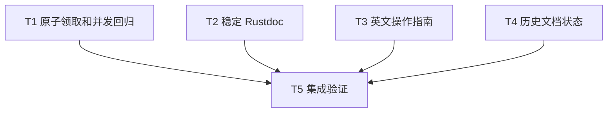

# rs-operation 本轮评审修复实施计划

> **面向智能体执行者：** 使用 executing-plans 逐项执行并以 `- [ ]` 跟踪。独立任务可按下列并行批次安排；本计划本身不启动实施。

**目标：** 最小修复 OP-001～OP-004，保持公共 API 与下游调用方式。

**架构：** 原子领取清理 future，锁外执行用户代码；修正文档中的不稳定断言、双语操作缺口与历史状态。

**技术栈：** Rust edition 2024，MSRV 1.94，固定工具链 1.94.0；std Future、Mutex、Barrier/channel；Markdown 和 Rustdoc。

**设计依据：** [本轮设计](design-20261113T052055318Z-23ee552e.md)。

**保存位置：** 用户指定项目 doc 目录，不使用临时目录保存本计划。测试示例用的临时验证工程可置于仓库外，不取代正式交付文件。

## 范围与全局要求

纳入 OP-001（P1：并发清理领取）、OP-002（P2：竞争 doctest）、OP-003（P2：英文指南）、OP-004（P2：历史设计状态）。无明确搁置或拒绝条目。保持用户当前 Paseo workspace，不创建或打开新的 Paseo workspace。

开始时重新读取 Git 状态、适用 AGENTS.md、当前源码及项目门禁配置。保留已有未提交内容，不覆盖或丢弃。文档生成阶段的只写方案边界已在两份方案交付时结束，不是实施阶段禁令。实施阶段提交与远端操作依届时授权处理，不从本计划推断额外授权。

允许为测试失败、ci-check.sh 错误、覆盖率不足新增或修改必要测试和源码，包括已存在的基线问题；记录原因和最小修复，不降低任何门槛，不扩大到无关重构。

## 调度图

T1、T2、T3、T4 无接口依赖，写入集合不交叉，属于同一可并行批次 A。可由当前执行者顺序处理，无须为此强制创建 agents。重型验证共享 target 和工具链，归 T5 串行运行；若叶子验证与其他 Cargo 命令共享 target，错峰执行。

| 任务 | 前置任务 | 最小解锁产物 | 写入集合（项目相对路径） | 本地验证 | 集成验证归属 | 审查时机 |
| --- | --- | --- | --- | --- | --- | --- |
| T1 | 无 | 原子领取实现与受控回归 | src/resource/cleanup_scheduler/cleanup_task.rs；必要时 src/resource/cleanup_scheduler/tests.rs 与父模块测试声明；tests/contract_cleanup_tests.rs | 定向单元测试和 cleanup 契约 | T5 | 立即审查 |
| T2 | 无 | 稳定的类型示例 | src/driver/portable_driver.rs | PortableDriver doctest | T5 | 批量审查 |
| T3 | 无 | 双语能力对照与英文操作路径 | doc/user_guide.md；必要时 doc/user_guide.zh_CN.md、README.md、README.zh_CN.md | 示例编译执行、相对链接核查 | T5 | 批量审查 |
| T4 | 无 | 历史状态说明 | doc/design-0.1.0.zh_CN.md；doc/implementation-plan-0.1.0.zh_CN.md | 对照源码检查状态声明 | T5 | 批量审查 |
| T5 | T1、T2、T3、T4 | 四项修复及审查结论 | 必要的门禁修复文件，变更前记录原因；不与叶子任务并发写入 | 全量门禁、coverage、文档核查 | T5 | 立即审查 |

## 任务拓扑依赖图



## T1：OP-001 原子领取及回归

输入接口：现有 `CleanupTask::poll_at(&mut self, cx: &mut Context<'_>, now: MonotonicTime) -> Poll<CleanupObservation>` 与 `CleanupResponsibility::task(ResourceId) -> Option<CleanupTask>`。输出保持签名不变。

- [ ] 阅读 cleanup_task.rs、cleanup_task_inner.rs、cleanup_responsibility.rs、cleanup_scheduler.rs、contract_cleanup_tests.rs 的当前版本。
- [ ] 增加受控双观察者测试。为旧版本的检查／领取窗口提供 `cfg(test)` 单元测试同步点，测试等待必须有超时诊断且不持生产状态锁；不得通过增加公开 API 注入钩子。旧版先让两个观察者通过检查再领取，稳定记录内部 expect panic。修复后同步点移至完整原子区间之前，同一竞争测试应不再 panic。
- [ ] 使用受控 Pending future 记录同时 poll 数与析构数：A 持有 future 时 B 返回 Pending；A 返回 Pending 后另一观察者能继续驱动；A 完成后 B 返回 AlreadySettled；断言最大同时 poll 数 1、析构一次、active 最终为 0。用不同 ResourceId 独立构造各测试，避免全局测试钩子影响其他任务。
- [ ] 运行 `cargo test --lib cleanup_scheduler --locked -- --nocapture`，确认新增测试确实被发现且旧实现失败，不将过滤后零测试算作验证。
- [ ] 将 poll_at 的领取段改为以下结构，保持后续 catch_unwind 和 finish_poll：

```rust
let mut future = {
    let mut task = self.state.inner.lock()
        .unwrap_or_else(|poisoned| poisoned.into_inner());
    if task.settled {
        return Poll::Ready(CleanupObservation::AlreadySettled {
            resource_id: self.resource_id,
        });
    }
    if task.polling {
        return Poll::Ready(CleanupObservation::Pending);
    }
    if let Some(deadline) = task.deadline {
        if now.domain != deadline.domain {
            return Poll::Ready(CleanupObservation::ClockDomainMismatch {
                resource_id: self.resource_id,
            });
        }
        if !task.unconfirmed_reported && now.ticks >= deadline.ticks {
            task.unconfirmed_reported = true;
            return Poll::Ready(CleanupObservation::Unconfirmed {
                resource_id: self.resource_id,
            });
        }
    }
    let future = task.future.take()
        .expect("cleanup future is retained by its task");
    task.polling = true;
    future
};
```

- [ ] 如实补充 poll_at Rustdoc 的多观察者语义；不承诺 Pending 观察者自动登记独立唤醒。
- [ ] 再运行定向单元测试与 `cargo test --test contract_cleanup_tests --locked`；核对期限、错误域、panic、恢复责任和 permit 行为未退化。
- [ ] 审查锁外 poll／析构、完成状态与唯一 permit 释放，移除任何会影响发布构建的测试设施。

## T2：OP-002 消除竞争示例

输入为 PortableDriver 类型 Rustdoc，输出保持所有生产 API 不变。

- [ ] 删除 `assert_eq!(driver.task_count(), 1);`，保留 spawn 成功与非零句柄断言。
- [ ] 在示例旁添加英文说明：`The worker may finish immediately; task_count is only a snapshot.` 不增加阻塞设施或新的任务计数保证。
- [ ] 运行 `cargo test --doc driver::portable_driver::PortableDriver --locked`，确认该示例实际执行并通过；若当前 Rustdoc 路径过滤不同，用测试列表定位真实名称后运行，记录实际命令。

## T3：OP-003 补齐英文指南

输入为两版指南、README、公开 API 和 examples；输出是英文读者可以独立走通的相同能力集，不改变 API。

- [ ] 建立中文章节／英文对应操作／源码或示例证据三列对照，覆盖设计中列出的七组路径。
- [ ] 在英文基础路径提供完整 MIME 输入清理示例，取自当前公开 API 和 mime_lifecycle.rs，解释结果与资源释放各自的检查点；明确业务适配器由应用提供。
- [ ] 逐项补齐准入失败、上下文、子操作提交、策略、转移、恢复 key、服务资源、关闭超时后观察和排障。每段代码说明前置对象及所属位置；主路径不得只有类型清单或跳转链接。
- [ ] 核对所有方法签名、枚举变体、默认值、依赖版本。不得把示意接口写成现有 API，不能承诺取消可中断 native 调用。
- [ ] 将完整片段拼装到仓库外临时 Cargo 工程，本地源码依赖只用于验证，运行 `cargo check --manifest-path <实际验证工程>/Cargo.toml`；可运行基础示例用对应 manifest 的 `cargo run` 检查 MIME 输出和释放断言。交付文档使用 `qubit-operation = "^0.1"`。
- [ ] 核查相对路径及标题锚点，中英语言切换和 README 导航；仅必要时同步中文版及 README，保留已有用户改动。

## T4：OP-004 纠正文档状态

- [ ] 将旧设计顶部改为“历史设计基线；公共 API 已有实现，原文示意签名不作为当前 API 教程；当前用法见用户指南及源码”。保留原始设计时间和初始化提交，不声称完成未验证的验收。
- [ ] 将旧实施计划顶部标为历史任务拆解，说明“空骨架”是原始起点、复选框不是当前待办清单、不能自动据此重跑旧计划。链接本轮方案用于识别本次增量修复。
- [ ] 阅读原文状态表述及实现契约，确认没有将真正未实现的行为描述为已实现；对无法逐项确认的差异明确写未核对。
- [ ] 核查链接和状态说明的一致性，不翻译整套历史设计、不修改历史任务完成勾选来伪造验收记录。

## T5：集成、门禁与交付

- [ ] 等 T1～T4 全部完成后审查 diff，检查 OP 编号逐项有产物，保留已有改动且无意外 API／依赖变化。
- [ ] 运行 `./.infra/bin/align-ci.sh`；若改变源码，复核相关文件与受影响测试。
- [ ] 串行运行 `cargo check --workspace --all-targets --locked`、`cargo test --locked`、`cargo check --examples --locked`、`RUSTDOCFLAGS="-D warnings" cargo doc --no-deps --locked`。cargo test 包含全量 doctest；记录各退出码，不把编译通过等同测试通过。
- [ ] 运行 `./.infra/bin/ci-check.sh` 和 `./.infra/bin/coverage.sh`，按当前项目和基础设施配置检查全部要求；若 ci-check 已运行同等 coverage 门禁，可引用其完整输出，不重复昂贵检查。不得调低阈值、屏蔽错误或用未执行的历史结果替代。
- [ ] 对失败先分类：本轮回归、已有基线缺陷或环境问题。必要时增加／修改测试及源码以修复前两者，记录依据并重跑受影响验证及失败门禁；环境阻塞如实报告，不宣称通过。
- [ ] 只读对照 rs-magika/src/managed_runtime/managed_inference_runtime.rs 和 task_control.rs，确认 reserve/attach/commit 与 ManagedOperationControl 无迁移需求；本轮不以其他下游设计文字冒充集成测试结果。
- [ ] 最终逐项报告 OP-001～OP-004 的改动、验证命令／退出码、覆盖率结论与剩余限制。提交、推送等收尾操作依据未来实施命令的明确授权处理。

## 计划自检映射

| 必须项 | 任务 |
| --- | --- |
| 原子领取、锁外用户代码、并发／完成／permit 回归 | T1 |
| 稳定 Rustdoc 示例 | T2、T5 |
| 英文独立操作路径、双语事实与链接一致 | T3、T5 |
| 历史状态不误导、不虚报验收 | T4 |
| 兼容性与下游核查 | T5 |
| 完整门禁、覆盖率及必要基线修复 | T5 |

调度表、拓扑图和任务列表均为 T1～T5；本计划未执行任何实现或验收命令。
